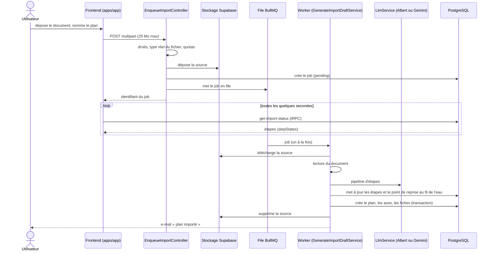
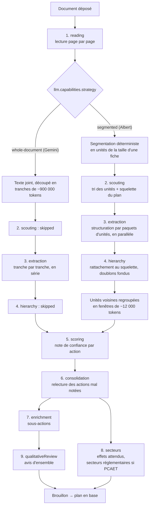
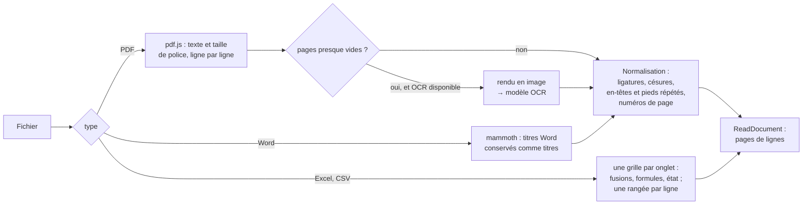
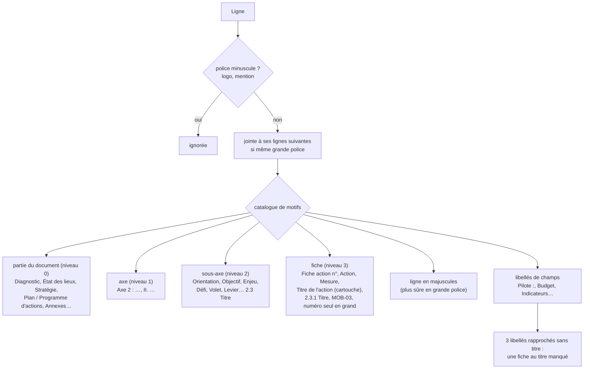
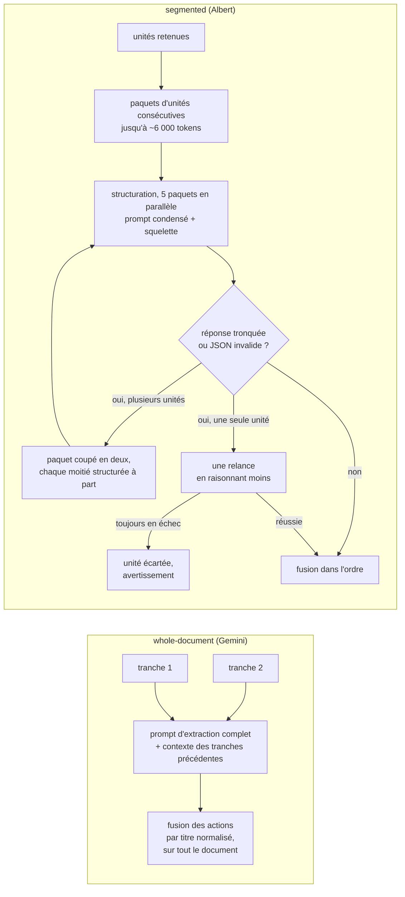

# Import IA d'un plan d'actions

Une collectivité dépose son PCAET en PDF, Word, Excel ou CSV, ou son document
Électrification en DOCX. L'import en tire les axes, sous-axes, actions et
sous-actions, puis crée le plan dans Territoires en Transitions. Le plan créé
est marqué "importé par l'IA" et reste à relire.

Deux fournisseurs de modèles sont branchés derrière `LlmService`, au choix par
`LLM_PROVIDER` :

| | Albert API (défaut) | Gemini |
|---|---|---|
| Opérateur | DINUM, socle interministériel | Google, via Vertex AI |
| Modèles | un par palier : `gpt-oss-120b` (fort), `ministral-3-8b` (léger), `lightonocr-2-1b` (OCR) | `GEMINI_MODEL` pour tout |
| Fenêtre du modèle fort | 131 000 tokens | 1 000 000 tokens |
| Stratégie | `segmented` : le document en morceaux de la taille d'une fiche | `whole-document` : le document en quelques grandes tranches |
| OCR des pages scannées | oui | non |
| Quotas | 128 000 tokens d'entrée et 10 requêtes par minute, par modèle | pas de limite connue |

Le code ne teste jamais le nom du fournisseur : tout passe par
`llm.capabilities` (`strategy`, `ocr`) et par `maxInputTokensFor(tier)`. Changer
de fournisseur se fait par la seule variable `LLM_PROVIDER`.

> **Appels payants.** Chaque import appelle un modèle externe. Les tests
> automatisés utilisent un faux modèle, et un agent ne lance jamais d'import
> réel (voir le `CLAUDE.md` racine). Pour mesurer la qualité à la main :
> [`eval/README.md`](eval/README.md).

## Vue d'ensemble



Garde-fous à l'entrée (`enqueue-import/`, `ai-plan-import.constants.ts`) :

- tout type de plan s'importe, et un plan peut ne pas en avoir : le profil
  `generic` sert de repli au moteur documentaire. Le type PCAET y ajoute les
  secteurs réglementaires ; le type Électrification impose son parcours dédié
  (annexe 3 en DOCX) et reste refusé par le profil `generic` ;
- le serveur combine la liste `AI_PLAN_IMPORT_ALLOWED_PROFILES` et le flag
  global `is-ai-plan-import-enabled`, pour les capacités et le lancement.
  Électrification exige aussi `is-electrification-plan-creation-enabled`.
  Le mode super-admin actif contourne les deux flags ; la liste des profils
  autorisés, les droits et les validations métier restent applicables ;
- un seul import en cours par utilisateur (409), dix par collectivité et par
  24 heures (429), vingt en cours au total ;
- le type du fichier est vérifié sur son contenu, pas sur son extension ; une
  archive Office (xlsx, docx) est inspectée avant d'être acceptée ;
- 25 Mo compressés, 100 Mo décompressés.

## Le pipeline

`pipeline/run-import-pipeline.ts` enchaîne neuf étapes. Chacune se termine en
`ok`, `skipped` ou échoue, et son état est écrit en base pour la barre de
progression du frontend. Les deux stratégies partagent la lecture et les
étapes de vérification ; elles diffèrent sur la façon de découper et de
structurer.



Les étapes 5 et 6 sautent si l'utilisateur désactive les vérifications,
l'étape 7 s'il désactive les sous-actions. L'étape 8 tourne pour tout plan :
elle propose les effets attendus de chaque action, parmi la table
`effet_attendu` lue en base au lancement, et, pour un PCAET seulement, ses
secteurs réglementaires, dans le même appel. Pour un
tableur que le code lit en entier, seuls les secteurs et l'avis appellent le
modèle : l'extraction reprend les actions lues, les étapes 2 et 4 à 7
sautent (voir [Tableurs](#tableurs-pipelineanalyze-workbook)).

Les secteurs tournent en parallèle de l'enrichissement puis de la revue : ils
ne lisent rien de ce que l'enrichissement écrit, et la revue ne lit pas les
secteurs. Sans sous-actions demandées, celles de la consolidation sont vidées
avant les deux branches. Un point de reprise s'écrit dès que la suite des
étapes faites, dans l'ordre 7, 8, 9, s'allonge : la revue faite avant les
secteurs n'en écrit pas, et le point de reprise après l'enrichissement ne
contient ni la revue ni les secteurs. Une branche en échec, ou qui lève,
annule l'autre : la reprise referait de toute façon ses appels.

Avant la création du plan, le brouillon est normalisé
(`adapters/extracted-action-to-import-action.ts`) : le numéro qui précède un
titre d'action est gardé sous une seule forme (« Action 3 - » devient « 3 »,
« 2.1.3. » devient « 2.1.3 ») ;
un même axe ou sous-axe libellé de deux façons (mêmes mots aux accents et à
la casse près) prend une seule graphie, en casse normale de préférence, et un
numéro nu (« Axe 6 ») rejoint le seul libellé complet de ce numéro, et les
espaces multiples d'un libellé d'axe ou de sous-axe sont écrasés ; les
doublons exacts sont écartés. Enfin `adapters/remove-duplicated-content.ts`
retire, sans appel au modèle ni réécriture, ce que la description répète
d'un autre champ : une ligne déjà présente dans les objectifs, les
sous-actions, les pilotes, les partenaires, le budget, les financements ou
les moyens (mots comparés sans casse, accents, ponctuation ni puce ; ligne
incluse telle quelle, ou à 90 % dans l'ordre, ou faite à 80 % des noms
d'organismes déjà rangés), un libellé de cartouche seul (« Référent
interne »), la répétition du titre ; un intertitre « … : » reste tant que sa
suite reste. Une sous-action qui reprend un objectif, sans pilote, statut ni
date propres, est retirée. Les actions lues dans un tableur n'y passent pas.
Les comptes sont dans `stats.content` (`removedDescriptionLines`,
`removedObjectifSousActions`).

La lecture (étape 1) porte aussi un garde-fou déterministe,
`pipeline/detect-document-tome/` : un PCAET se publie en plusieurs tomes, et
seul le programme d'actions s'importe. Si la zone de titre (premières pages,
lignes courtes de page de garde et de sommaire) annonce un tome qui ne
contient jamais de fiches actions — évaluation environnementale stratégique,
résumé non technique, diagnostic — l'import échoue immédiatement avec un
message qui cite la ligne fautive, avant tout appel au modèle. Une
« stratégie » passe (l'import sert aussi hors PCAET, et un plan stratégique
peut porter des fiches). Un titre de programme d'actions ancré en début de
ligne l'emporte toujours (cas du PCAET global qui contient aussi son
diagnostic), et les tableurs ne sont pas concernés.

Une étape en échec arrête l'import, qui n'enregistre alors aucun plan. Le
résultat du pipeline garde toutefois les actions d'avant l'étape fautive et
les avertissements accumulés : l'évaluation les mesure, pour comprendre ce qui
a fait échouer l'étape.

### Pourquoi deux stratégies

Gemini lit un PCAET de 300 pages d'un coup et en extrait fidèlement les
actions. `gpt-oss-120b`, lui, **résume au lieu d'extraire** dès qu'on lui
donne une grande tranche. Sur le même document, il a rendu 31 actions pauvres
là où Gemini en rendait 224, et sa fenêtre de 131 000 tokens impose de toute
façon plusieurs tranches, qui se contredisent sur la hiérarchie : 23 sous-axes
au lieu de 11. La stratégie `segmented` lui donne à lire des morceaux de la
taille d'une fiche, avec la structure du plan établie à part.

## 1. Lecture (`pipeline/read-document/`)



- Une page de moins de 200 caractères est candidate à l'OCR. Si au moins 80 %
  des pages le sont, le document est un scan : au-delà de 60 pages, il est
  refusé avec un message qui propose d'exporter le seul programme d'actions.
- Une page blanche ou une photo n'est pas un échec d'OCR. Un échec sur un
  document qui a du texte laisse la page telle que pdf.js l'a lue ; seul un
  scan intégral échoue au-delà de 20 % de pages en échec. Sur un document qui
  a du texte, après 3 erreurs du fournisseur d'affilée (quota, panne, requête
  refusée), les pages restantes ne sont plus tentées et restent telles que
  pdf.js les a lues. Un délai dépassé ou une réponse tronquée vient de la page,
  le modèle bouclant sur une photo : il ne compte pas, sans remettre le compte
  à zéro.
- La réponse de l'OCR est plafonnée à 3 500 tokens par page, au-delà desquels
  le modèle répète en boucle ce qu'il voit sur une photo. Une page presque
  vide d'un document qui a du texte a 30 secondes pour être transcrite, une
  page d'un scan intégral 90 secondes. Le délai dépassé annule l'appel et ses
  relances, qui libèrent leur place auprès du modèle.
- Gemini n'a pas d'OCR branché : un scan intégral y aboutit à « document sans
  texte ».
- Un tableur échappe à la normalisation, faite pour les pages d'un PDF : la
  première rangée commune à plusieurs onglets (un bandeau d'ambition) n'y est
  pas un en-tête de page. Chaque onglet garde sa grille
  (`pipeline/analyze-workbook/`) : cellules fusionnées, formules et leur
  résultat, onglets masqués. Le texte d'un onglet tient une rangée par ligne ;
  une valeur fusionnée n'y est écrite qu'à sa première rangée, et le texte
  joint annonce chaque onglet par « [Onglet « nom »] ».

### Tableurs (`pipeline/analyze-workbook/`)

Un classeur porte sa hiérarchie dans ses colonnes et ses cellules fusionnées,
que le texte aplati perd. La lecture analyse donc chaque onglet sans le
modèle (`analyze-workbook.ts`), et ne confie au modèle que ce qu'elle n'a pas
su lire. Le moteur attend des **rôles**, pas un format : des fiches
(obligatoires), éventuellement une hiérarchie au-dessus et des sous-actions
dessous, et des attributs (pilote, statut, calendrier ou dates, budget,
financement, indicateurs, commentaires). Aucune lettre de colonne, aucun
libellé ni aucune position n'est attendu : le rôle d'une colonne se déduit de
son contenu (blocs fusionnés ou répétés, cardinalité, nombres, croix, dates,
liste fermée), et son libellé ne fait que départager, par un synonymier
(`match-column-label.ts`). Un libellé que le contenu contredit (« PILOTE »
au-dessus des sous-actions) donne un avertissement.

| Rôle d'onglet | Reconnu quand | Ce qu'il devient |
|---|---|---|
| `plan` | fiches aux titres rédigés et distincts, et une hiérarchie (deux niveaux, bandeaux ou sous-actions) ou un tableau plat au libellé de titre reconnu et aux attributs de fiche (pilote, statut, dates) | actions construites par le code, épinglées |
| `complement` | ≥ 60 % de ses n° ou titres retrouvés dans un onglet `plan` | indicateurs et cibles ajoutés aux `objectifs` des fiches ; jamais d'action |
| `synthese` | surtout des formules vers d'autres onglets, ou des nombres (hors montants d'une fiche) | ignoré, avec un avertissement ; confié au modèle si aucun onglet ne se lit |
| `liste` | une colonne courte dont les valeurs reviennent ailleurs | ignoré ; confirme une colonne statut |
| `masque` | onglet masqué | ignoré, avec un avertissement |
| `modele` | rien de reconnu avec confiance | lu par le modèle, comme un document |

| Forme | Exemple | Lecture de la hiérarchie |
|---|---|---|
| horizontale | colonnes de cellules fusionnées ou répétées (suivi de PCAET) | colonnes à blocs emboîtés, de la plus grossière à la plus fine, sous les bandeaux |
| verticale | rangées de titre isolées (« Axe 1 – … », « 1.2 … ») | bandeaux, niveau donné par la numérotation |
| numérotation | une colonne « N° » qui vaut 1, 1.2, 1.2.3 | profondeur du code : la fiche est la moins profonde à porter des attributs, au-dessus des axes, en dessous ses sous-actions |
| un onglet par axe | « Axe 1 Mobilité », « Axe 2 Habitat »… | nom d'onglet ou titre au-dessus du tableau, puis l'une des formes ci-dessus |
| fiche-formulaire | un onglet par fiche, paires libellé / valeur, dont un titre | champ « Axe », sinon nom d'onglet ; suivie d'un tableau d'étapes, l'onglet part au modèle |
| tableau plat | une rangée par fiche, CSV, modèle d'import de la plateforme | colonnes à forte répétition, remplies vers le bas pour un CSV |

La fiche est le niveau le plus fin qui porte un titre stable sur plusieurs
rangées, ou un n° ; une colonne qui change à chaque rangée sous elle donne
les sous-actions, sinon une rangée est une fiche. Une colonne écartée par
son libellé (« Objectif ») ou parce qu'elle ressemble à une liste fermée
(peu d'axes aux intitulés courts) redevient un niveau d'axe quand un niveau
retenu s'emboîte dans ses blocs. Une rangée prise dans une fusion de données,
ou qui écrit un statut, n'est jamais un en-tête : une feuille sans en-tête se
lit par son contenu seul.

Rien n'est jeté. Une colonne non reconnue, un avancement rédigé ou une date
sans libellé de date (« Date de mise à jour ») rejoignent la description en
« Libellé : valeur » ; une échéance en texte (« Fin 2026 », « Juin 2025 ») ou
un montant illisible y restent tels quels, avec un avertissement. Les
statuts passent par une table (`map-tabular-statut.ts`), puis par une
correspondance approchée stricte ; un avancement chiffré (0,5 ou 50 %) se lit
dans une colonne qui se dit d'avancement ; une case vide ne donne aucun
statut, et celui d'une fiche s'agrège de ses sous-actions. Les dates d'une
sous-action vont du 1er janvier de la première année cochée au 31 décembre de
la dernière. Le budget d'une fiche somme ses colonnes de budget annuel, ou
prend leur total ; il est contrôlé contre la formule de total, et une rangée
ajoutée sous une plage de `SUM` restée courte reste une fiche. Les cellules
en erreur (« #REF! ») et les formules sans valeur calculée se lisent vides,
avec un avertissement. Les champs désactivés par l'utilisateur sont vidés par
le code.

Dans le pipeline :

- les actions lues par le code entrent dans `progress.actions` dès la
  lecture, avec leur texte source (une tranche par fiche, regroupées en
  fenêtres) : la reprise les retrouve sans relire le classeur ;
- unités et tranches ne sont calculées que sur les onglets `modele` ; sans
  onglet `modele`, le repérage saute et l'extraction n'appelle pas le
  modèle. Le plafond d'unités compte aussi les fiches lues par le code, que
  les secteurs et la revue lisent encore ;
- une action épinglée (`sourceTableur`) n'est ni rattachée ni fondue par la
  mise en cohérence, ni notée, ni corrigée, ni enrichie ; la mise en
  cohérence saute quand toutes le sont, et les étapes 5 à 7 aussi ;
- les consignes de l'utilisateur et les vérifications ne s'appliquent pas
  aux onglets lus par le code : un avertissement du rapport le dit.

`eval/run-ai-import-eval.ts --lecture-seule` montre le rôle de chaque onglet
et de chaque colonne, l'arbre obtenu et les avertissements, sans aucun appel
au modèle : on essaie un nouveau classeur sans coût.

## 2. Segmentation et repérage (Albert seulement)

### Segmentation déterministe (`pipeline/segment-document/`)

Aucun appel au modèle : on reconnaît les titres, on coupe aux frontières des
fiches, puis on ramène chaque unité entre 1 000 et 3 500 tokens (les petites
fusionnent avec leur voisine, les grandes sont fenêtrées avec une reprise).
Deux unités de deux axes différents ne fusionnent que si les deux sont
petites : le tableau d'un axe ne se dilue pas dans celui du suivant.

Chaque unité garde ses pages, son chemin de titres (axe > sous-axe) et la
partie du document qui la contient (diagnostic, stratégie, plan d'actions,
annexes…).

Un onglet de tableur confié au modèle se découpe d'après sa grille
(`segment-document/cut-tabular-units.ts`), lue comme l'analyse des classeurs
la lit (`detectTableHeader`, `classifyGridRows`, `readColumnBlocks`) :

- l'en-tête (une ou deux rangées, « CALENDRIER · 2021 ») est répété en tête de
  chaque unité, les titres au-dessus ne le sont pas ;
- un bandeau ouvre une unité, et son texte rejoint le chemin de titres après
  l'onglet ;
- la coupe tombe entre deux blocs de la colonne de regroupement la plus fine
  (valeurs fusionnées ou répétées sur plusieurs rangées, sans réemploi d'un
  bloc à l'autre : en général la fiche) ;
- une unité qui commence au milieu d'un regroupement s'ouvre sur « [Suite de :
  … » et les valeurs fusionnées en cours.



Ce que la mise en page trompe, et comment la segmentation s'en garde :

- deux colonnes côte à côte : la lecture sépare deux morceaux de texte d'une
  même ligne quand plus de deux hauteurs de police les séparent, sans détacher
  un numéro ou un libellé court de sa valeur ;
- un tableau à colonnes ou des cartes côte à côte : lue ligne par ligne, la
  page mêlerait sur une même ligne une action, son objectif et son porteur.
  `read-document/read-column-table.ts` la relit colonne par colonne. Un tableau
  dont l'en-tête nomme les actions (« Enjeux | Objectifs | Actions | Portage »)
  sort rangée par rangée, chaque valeur précédée de son libellé, le
  regroupement de gauche en titre, et se poursuit d'une page à l'autre. Des
  cartes (trois colonnes de même gabarit, ou deux au texte centré) sortent
  l'une après l'autre, leur premier bloc en titre de fiche. Toute autre page
  reste lue ligne par ligne ;
- un titre sur plusieurs lignes : recollé jusqu'à quatre lignes de même
  police ; un titre explicite (« ACTION 2 - … », « OBJECTIF 2 - … ») admet une
  suite plus longue dans une autre grande police, mais n'avale jamais le titre
  explicite suivant. Sa phrase qui passe à la ligne en casse de phrase
  (« Action 3 : … et évaluer » puis « l’efficacité des actions… ») est
  recollée quand elle garde sa police et son interligne, hors rangée de
  tableau, et que son premier mot n'aurait pas tenu sur la ligne du dessus ;
  une ligne en capitales sous un titre en casse de phrase (« CONTEXTE ET
  ENJEUX ») reste à part, sauf après un mot-outil (« … incitative en » puis
  « REOMI ») ;
- le tableau récapitulatif : une page qui aligne au moins quatre lignes
  « 2.1.3 Titre » presque sans texte entre elles n'ouvre aucune fiche ;
- le bandeau d'objectif en tête de fiche (« 1- AMELIORER… » juste au-dessus de
  « ACTION 2 - … ») est le sous-axe, pas une fiche ;
- l'axe et l'orientation redits sous le titre de la fiche (« Action 31 : … »
  puis « Axe stratégique 4 : … ») la rattachent sans la refermer, quand la
  moitié au moins des fiches du document font de même ; ailleurs, un axe qui
  suit une fiche courte ouvre la suite ;
- un titre de partie en corps de texte juste après une fiche (« Suivi et
  évaluation ») est un intertitre de la fiche ;
- un document qui nomme ses axes (« AXE STRATEGIQUE 4 ») ne prend pas une
  ligne en majuscules pour un axe, sauf si elle se dit axe (« AXE
  TRANSVERSAL »).

### Tri et squelette (`pipeline/scout-units/`)

- **Tri** (palier léger, lots de 40) : chaque unité est classée `fiche_action`,
  `structure`, `diagnostic`, `engagement_partenaire` ou `autre`, sur ses 600
  premiers caractères et sa place dans le document. On écarte le diagnostic,
  l'éditorial et les engagements de partenaires.
  Une unité que la segmentation tient pour une fiche reste toujours, tout comme
  une unité que le modèle a oubliée : mieux vaut lire un extrait de trop que
  perdre une action.
- Une partie titrée « Engagement(s) des partenaires » est écartée d'office,
  sans appel : ce sont les engagements d'autres acteurs, pas le plan de la
  collectivité.
- Quand une partie titrée « Plan / Programme d'actions » ou « Fiches actions »
  contient au moins trois fiches, seule cette partie est structurée : un PCAET
  suit une structure réglementaire, et le diagnostic, la stratégie ou les
  annexes n'ont pas d'action à donner. Sans partie de ce type, tout est lu.
  Le sommaire placé avant cette partie (« 14 ACTIONS PRIORITAIRES » et leurs
  thèmes) va pourtant au squelette, sans tri ni appel : sa page redit au
  moins la moitié des titres de fiches, et c'est souvent lui seul qui donne
  leurs regroupements. Sur deux colonnes, toutes ses unités de la page y vont.
- Avec des fiches, un extrait classé `structure` (sommaire, tableau
  récapitulatif) sert au squelette mais n'est pas structuré : il redit ce que
  les fiches détaillent. Sauf si les tableaux du document numérotent nettement
  plus d'actions qu'il n'a de fiches (51 lignes « Action à engager 31 : … »
  pour 24 fiches) : ils portent alors des actions que nulle fiche ne
  détaille, et restent lus quoi qu'en dise le tri, qui n'en voit que le début
  et la fin. Quand l'utilisateur ne garde que les actions qui ont une fiche
  (voir la question plus bas), ces tableaux ne vont qu'au squelette. Le
  périmètre lu et ce compte sont partagés avec la question
  (`segment-document/list-actions-without-fiche.ts`) : les deux ne divergent
  jamais.
- Après la structuration, les actions de même titre (à la casse, aux accents,
  à la ponctuation et à la numérotation près : « ACTION 3 - » et « 2.1.3 »)
  sont fondues sur tout le document, sur la version la plus complète. Deux
  actions qui ont chacune du contenu restent distinctes quand leur axe, leur
  sous-axe ou leur numéro (« 2.1.3 » et « 2.2.4 », « Fiche 3 » et « Fiche 7 »)
  diffèrent ; deux sous-axes se comparent par leur numéro, par leur libellé
  quand aucun n'en a, et un sous-axe numéroté d'un seul côté ne distingue
  rien. Un tableur dont chaque rangée est une fiche n'est pas dédoublonné,
  quelle que soit la stratégie : aucune rangée n'y est l'écho d'une autre. Il
  l'est quand ses fiches s'étendent sur plusieurs rangées fusionnées, car le
  modèle peut alors rendre deux fois une fiche coupée entre deux extraits.
- **Squelette** (palier fort, un appel) : les axes et sous-axes du plan, tirés
  des titres relevés et des extraits de structure (sommaire, tableau
  récapitulatif). Il sert ensuite de référence à la structuration et à la mise
  en cohérence.

## 3. Extraction



Le prompt d'extraction (Gemini) et celui de structuration (Albert) partagent
leurs règles de contenu (`prompts/field-rules.ts`), que la consolidation
reprend pour la description et les sous-actions : chaque information dans un
seul champ, le plus spécialisé ; description réduite au texte de
présentation qu'aucun autre champ n'accueille, sans résumé ; jamais un
objectif en sous-action ; cartouche lu colonne par colonne rapproché de ses
libellés, fragments orphelins écartés ; objectifs chiffrés en lignes « - »,
pilotes tirés d'un schéma d'acteurs, statut déduit du seul calendrier de l'action, et ni évaluation, ni
mesures ERC, ni engagements de partenaires lus comme des actions. Aucun ne
numérote une action que le document ne numérote pas.

Une réponse tronquée vient d'un paquet trop riche : le couper donne des
réponses plus courtes, là où un budget plus large laisserait le modèle écrire
plus longtemps. Sur Albert, un import échoue si plus de 20 % des paquets
perdent une partie de leurs unités ; en dessous, il aboutit et les unités
écartées sont signalées en avertissement.

Le budget de réponse est large (32 000 tokens) parce que `gpt-oss-120b`
raisonne avant de répondre : ses tokens de raisonnement se prennent sur la
même limite, sans apparaître dans l'usage retourné. `ALBERT_REASONING_EFFORT`
(`low`, `medium`, `high`) règle cet effort pour tout le modèle fort ; une
étape peut aussi le demander bas pour ses propres appels, ce que font le tri
et la mise en cohérence.

## 4. Mise en cohérence (Albert seulement, `pipeline/consolidate-hierarchy/`)

Des paquets lus séparément ne se coordonnent pas : l'un écrit « Axe 2 :
Mobilité », l'autre « 2. Mobilités durables ». Le modèle fort reçoit la liste
compacte des actions (index, axe, sous-axe, titre, par lots de 50) avec le
squelette complet, et rend pour chacune l'axe et le sous-axe exacts du
squelette, ainsi que l'action dont elle serait le doublon. Les doublons sont
fusionnés, et une action que le modèle a oubliée garde son rattachement
d'origine.

Cette étape améliore le résultat sans en être une condition : un lot tronqué
est coupé en deux, et un lot qui échoue encore garde les rattachements de
l'extraction, avec un avertissement. Elle ne fait jamais échouer l'import.

Passée ou non, l'étape se termine en retirant un sous-axe qui ne contient
qu'une action de même titre (`drop-redundant-sous-axes.ts`) : le sommaire et la
fiche se répondent, quelle que soit la stratégie.

## 5 à 8. Vérifications, sous-actions, avis

Communs aux deux stratégies. Sur Albert, les unités voisines sont regroupées
en fenêtres d'environ 12 000 tokens pour que ces étapes n'appellent pas le
modèle une fois par fiche.

- **scoring** : une note de confiance par action, en relisant la source.
- **consolidation** : les actions notées sous 90 sont reprises contre la source,
  par lots de 5.
- **enrichment** : les sous-actions, par lots de 30 actions.
- **qualitativeReview** : un avis d'ensemble sur le brouillon, sans la source.

Ces étapes améliorent le brouillon sans en être une condition : un lot en
échec laisse ses actions telles quelles, avec un avertissement et le compte
`failedBatches` dans la télémétrie de l'étape. Seule une erreur passagère
(quota, panne 5xx, coupure ou délai dépassé) sur tous les lots d'une étape,
relances épuisées, fait échouer l'import, pour qu'il se reprenne plutôt que de
rendre en silence un brouillon sans vérification.

Les secteurs (étape 8) font exception : même tous leurs lots en échec, ils ne
font jamais échouer l'import. Secteurs et effets attendus sont optionnels, et
la complétion par Communs propose ensuite les secteurs des fiches qui n'en ont
pas. Un avertissement signale alors qu'aucun secteur n'a été proposé. Un
identifiant d'effet attendu hors de la liste fournie est écarté (compte
`unknownEffetsAttendus`).

## Couche LLM (`utils/llm/`)

```mermaid
flowchart TD
    P[Étape du pipeline] -->|"generateStructured / generateText<br/>tier: strong | light | ocr"| SV[LlmService]
    SV --> CL[ConcurrencyLimiter<br/>appels simultanés]
    CL --> RL[ModelRateLimiters<br/>tokens et requêtes par minute,<br/>un seau par modèle]
    RL --> REP{LlmRepository}
    REP -- albert --> AR[AlbertRepository<br/>SDK OpenAI, chat/completions,<br/>json_schema, flux]
    REP -- gemini --> GR[GeminiRepository<br/>@google/genai, Vertex AI]
    AR --> OB[LlmObserver<br/>une trace par tentative]
    GR --> OB
    SV -. "429 ou 503" .-> PEN[modèle mis en pause 15 s,<br/>6 relances, 8 sur ~7 min chez Gemini]
```

- La réservation de quota se fait au moment de l'envoi : le fournisseur compte
  une requête quand elle part, pas quand elle entre dans la file.
- Sur Albert, chaque palier a son modèle et son quota ; un palier sans modèle
  retombe sur le modèle fort, et l'OCR est désactivé sans modèle image-texte.
- Sur Gemini, tous les paliers utilisent `GEMINI_MODEL`, et une image renvoie
  une erreur `unsupported`. L'enrichissement, les secteurs et la relecture
  finale demandent un `thinkingLevel` bas, propre à Gemini : Albert garde
  `ALBERT_REASONING_EFFORT`.
- La pause qui suit un 429 vaut aussi sans quota déclaré, donc chez Gemini.

Configuration (`utils/config/configuration.model.ts`) :

| Variable | Défaut | Rôle |
|---|---|---|
| `LLM_PROVIDER` | `albert` | `albert` ou `gemini` |
| `ALBERT_MODEL` | — | modèle fort, requis avec Albert |
| `ALBERT_MODEL_LIGHT` | `ministral-3-8b-instruct-2512` | tri ; vide : le modèle fort |
| `ALBERT_MODEL_OCR` | `lightonocr-2-1b` | OCR ; vide : désactivé |
| `ALBERT_MAX_INPUT_TOKENS_PER_MINUTE` | 128 000 | quota de tokens, par modèle |
| `ALBERT_MAX_REQUESTS_PER_MINUTE` | 10 | quota de requêtes, par modèle |
| `ALBERT_MAX_CONCURRENT_CALLS` | 2 | appels simultanés, tous imports confondus (une étape en demande jusqu'à 5) |
| `ALBERT_REASONING_EFFORT` | — | effort de raisonnement du modèle fort |
| `GEMINI_MODEL` | — | modèle Gemini |

## Robustesse de la segmentation

La segmentation est la partie la plus fragile du chemin Albert : c'est elle qui
décide où une fiche commence. Elle repose sur un catalogue de motifs courants
dans les plans français, pas sur la mise en page d'un document en particulier.
Mais elle n'a été calibrée que sur un seul PCAET réel (Métropole de Lyon,
286 pages).

Ce qui limite les dégâts quand elle se trompe :

- un titre manqué ne perd pas de texte : il est lu dans l'unité voisine, et
  les paquets de ~6 000 tokens contiennent de toute façon plusieurs unités ;
- sans aucun titre reconnu, le document est lu en fenêtres fixes ;
- la hiérarchie finale vient du squelette et de la mise en cohérence, pas
  seulement des titres détectés ;
- les motifs à risque exigent plusieurs indices à la fois : un numéro seul
  n'est un titre de fiche qu'en grande police, en majuscules, et dans la suite
  des numéros précédents.

Le [banc du découpage](eval/README.md#banc-du-découpage) mesure, sans appel au
modèle, ce que le code transmet au modèle pour chaque document d'un corpus de
plans réels, comparé à sa référence manuelle. Aucun score ne peut baisser :
**tout changement de la lecture ou de la segmentation se valide par lui**, pas
sur le seul document qui l'a motivé.

## Types de plan

Le moteur sert à tout type de plan. Ce qui dépend du type :

- les secteurs réglementaires (`withSecteurs`) ne sont demandés que pour un
  PCAET ; les effets attendus le sont pour tous ;
- hors PCAET, la phrase de rôle de chaque prompt nomme le type choisi
  (`prompts/plan-framing.ts`). Un PCAET, un plan sans type ou de type « Autre »
  garde la phrase de rôle d'origine ;
- cinq règles de `prompts/field-rules.ts` viennent de plans hors PCAET mais
  tiennent à la forme du document et valent pour tous : le niveau qui porte
  porteur, partenaires ou budget est l'action (« Mesure 1.1 » qui regroupe des
  actions A, B, C devient leur sous-axe) ; les fiches d'un autre plan, le bilan
  d'un programme précédent et une concertation ne donnent aucune action ; un
  tableau à colonnes lu ligne par ligne se recompose action par action ; les
  libellés « Portage », « Coût », « Public ciblé » ont leur champ ; « 2025 et
  années suivantes » ou « Court terme » ne sont pas des périodes fermées ;
- trois imports réels (plan de mobilité, COT, PAT) ont précisé le reste : un
  tableau dont chaque ligne est une action se lit comme des fiches, pas comme
  un récapitulatif (repérage) ; la liste d'objectifs en tête d'un axe n'est
  pas faite de sous-axes (squelette) ; une action n'est jamais reclassée par
  thème (hiérarchie), et un libellé retapé par le modèle reprend la graphie du
  squelette (`align-skeleton-labels.ts`) ; un sigle ne se développe pas, un
  libellé n'est pas une valeur, un montant par an n'est pas un budget ;
- le découpage (`segment-document/`) lit aussi les plans qui titrent
  « Fiche Action n°1.2 » sur une ligne et le titre dessous : leurs « Action 1 –
  … » sont des étapes, leurs lignes de calendrier (« Actions 1-2 x x x ») ne
  sont pas des titres, et le numéro de la fiche donne son axe quand les axes
  ne sont nommés qu'au sommaire ;
- il lit de même les fiches ouvertes par un cartouche « Axe stratégique |
  AXE 1 : … », « Titre de l'action | 1.1 … » : le champ nomme la fiche (sa
  valeur peut passer à la ligne), le rappel de l'axe complète un titre d'axe
  écourté, et les A, B, C de sa « Synthèse » sont ses sous-actions, pas un
  regroupement d'actions (squelette) ;
- le titre d'une action garde le numéro que lui donne le document, sous une
  seule forme (« Fiche n°12 : … » devient « 12 … ») : il fait le lien avec le
  document source et garde l'ordre des fiches (`normalize-plan-labels.ts`).
  Le modèle le garde ou le retire au hasard : quand il l'omet, le code remet
  celui de la fiche lue dont il reprend le titre (`structure-units.ts`) ;
- le thème posé juste au-dessus de plusieurs fiches (« BIODECHETS (restes
  alimentaires) » sur « Action 1. … », PLPDMA) est leur sous-axe, même en
  casse mixte ou dans la police du titre, et tous ces thèmes prennent le même
  niveau ; la fin d'un titre d'axe coupé sur deux lignes n'en est pas un ;
- le vocabulaire reconnu par le code couvre les autres plans : « Fiche projet
  n° », « Feuille de route », « Fiches projets », « Programme opérationnel »
  (`heading-patterns.ts`, `scout-units.ts`) ;
- le garde-fou de tome (`detect-document-tome.ts`) refuse toujours un
  diagnostic ou une évaluation environnementale déposés seuls, mais laisse
  passer un document global dont le sommaire annonce des axes ou des fiches,
  même si sa partie actions ne s'appelle pas « programme d'actions ».

Aucune référence d'évaluation hors PCAET n'existe encore : ces règles sont
couvertes par des tests hors ligne, pas par un import réel. Le nom des axes
reste imposé par le code (« Axe n : Titre ») : une « Brique » ou une
« Ambition » du document devient un axe numéroté.

## Reprise d'un import

Un import peut durer une demi-heure : tout arrêt du backend en cours de route
(redéploiement, redémarrage, crash) le coupait, et il fallait le relancer, au
prix de tous les appels au modèle. Il reprend désormais à sa dernière étape
terminée.

- **Point de reprise** (`ai_plan_import_job.checkpoint`) : après chaque étape
  terminée, la pipeline écrit son état (`pipeline/pipeline-checkpoint.ts`) :
  actions, texte découpé, squelette, avancement, le modèle pour lequel le texte
  a été découpé, et ce que le service avait relevé du document. Une étape faite
  n'est ni rejouée ni rappelée au modèle.
- **Reprise automatique** : le worker accepte une reprise d'un job « bloqué »
  (`maxStalledCount: 1`) ; une seule, pour qu'un document qui fait tomber le
  processus ne le relance pas en boucle. Après un arrêt, BullMQ le redistribue
  une fois son verrou expiré (dix minutes au plus), et `transitionToRunning`
  accepte un job déjà `running`. Un arrêt avant le premier point de reprise
  repart du document, encore présent dans le stockage.
- **Passage** (`ai_plan_import_job.attempt`) : 0 au premier, un de plus à
  chaque reprise. Toutes les écritures d'une exécution portent son passage :
  une exécution remplacée (verrou BullMQ perdu, job redistribué) n'écrit plus
  rien.
- **Reprise par l'équipe** (`resume-import/`) : un import en échec qui a un
  point de reprise se relance par `plans.aiImport.resumeAiImport`, réservé au
  super admin (`plans.fiches.import_resume`), depuis le bouton « Reprendre
  l'import » de la page du plan en échec ou de l'écran d'échec de l'import. Le
  job repasse `pending` et son plan `importing`. Un échec à la création du
  plan se reprend sans aucun appel au modèle.
- **Contrat incompatible** : le worker refuse un profil, une version ou un
  JSON de checkpoint qu'il ne sait pas traiter, sans repli générique. Il garde
  la source et le checkpoint ; l'API de suivi n'annonce pas ce job comme reprenable.
  Les checkpoints génériques v1 sans métadonnées de profil restent acceptés.
- **Modèle différent sur un checkpoint valide** : l'import repart du document
  s'il est encore là, sinon il échoue en le disant et n'est plus reprenable.
- **Rétention** : le point de reprise porte le texte du document, débarrassé
  des caractères que Postgres refuse en jsonb (`normalize-pages.ts`). Il est
  vidé à la réussite ; ceux des échecs ne sont plus reprenables après sept
  jours et sont purgés au démarrage du backend et au prochain import de la
  collectivité.

Un échec métier (document trop long, modèle en erreur) reste définitif
(`attempts: 1`) : seule l'équipe peut le reprendre.

## Questions à l'utilisateur

Certains documents laissent plusieurs lectures, toutes défendables, qui
relèvent d'une convention de la collectivité et non du document. L'import les
demande au lieu de les deviner. La règle première est la fiabilité : un
document clair ne reçoit aucune question. Chaque question repose sur une
détection déterministe, sans modèle, qui exige une preuve tirée du document,
et le banc vérifie sur le corpus qu'elle ne se pose que là où elle est
attendue.

| Sorte (`kind`) | Ce qui est demandé | Proposé | Détecteur |
|---|---|---|---|
| `action-level` | la fiche (ou la mesure) est-elle l'action, ou chacune de ses étapes (ou de ses éléments) ? | selon le document | `segment-document/detect-headings.ts` |
| `theme-grouping` | un axe par thème de la synthèse, ou un par thème écrit sur les fiches ? | `grouped` | `segment-document/detect-theme-grouping.ts` |
| `actions-without-fiche` | créer aussi les actions qu'un récapitulatif liste sans fiche ? | `all` | `segment-document/list-actions-without-fiche.ts` |

Le fonctionnement est commun aux trois :

- **Pause** : après la lecture, avant le premier appel au modèle. Tous les
  doutes du document (`detectReadingDoubts`, `segment-document.ts`) partent
  dans la même pause. Ni tableur ni stratégie `whole-document` : pas de
  question. Un document en grande partie illisible n'en reçoit pas non plus
  (voir « Abandon motivé »).
- **Stockage** : la colonne `question` (jsonb) porte
  `{ doubts, answer: { choices, answeredBy, answeredAt } | null }`, une union
  discriminée par `kind` (`models/import-question.ts`). Une question écrite
  sous l'ancienne forme à plat (un seul doute du niveau de l'action) se relit
  et se convertit, en base comme dans le point de reprise : un import en
  attente pendant un déploiement reprend sans relire son document.
- **Point de reprise** : le point `reading` garde les doutes et, quand le
  niveau de l'action est en doute, les unités des deux lectures
  (`pendingQuestion`). Le document reste jusqu'à l'issue de l'import : un point
  de reprise périmé d'ici la réponse (autre modèle, autre format) le fait
  relire.
- **Écran** (`apps/app/.../import-plan/ai-import-questions.form.tsx`) : les
  doutes d'une même pause s'affichent ensemble, une question par doute, la
  réponse proposée cochée, un seul bouton « Continuer l'import ». Page
  d'import, historique, démarche PCAET ; la page du plan renvoie vers la page
  d'import. Les exemples affichés (titres, pages, comptes) viennent du
  document.
- **Réponse** (`answer-import-question/`, `plans.fiches.import` sur la
  collectivité) : un choix par doute, ni plus ni moins, sinon refus
  (`ANSWER_MISMATCH`, 400). Le job repasse `pending` sous un nouveau passage.
  Une seconde réponse est refusée (`IMPORT_NOT_AWAITING_ANSWER`, 409).
- **Application** : sans modèle autant que possible
  (`pipeline/apply-reading-choices.ts`), sinon par une phrase ajoutée aux
  consignes de la structuration (`prompts/reading-choices-instructions.ts`,
  une entrée par sorte) ou au prompt du squelette. Le détail est donné par
  question ci-dessous.
- **Sans réponse** : l'import occupe sa collectivité et son auteur (un import
  en vol à la fois) mais pas le plafond global. Après sept jours, il échoue,
  son plan passe en échec dans la même transaction et sa source est supprimée,
  au démarrage du backend, au prochain import ou à une réponse tardive
  (`expire-import-questions/`).
- **Sans pause** (`pauseOnQuestion` absent : évals, specs) : les choix
  proposés valent réponse pour tout le passage (lecture, tri, squelette,
  jugement du doute du modèle, consignes), exactement comme le clic sur
  « Continuer l'import » : mêmes prompts, même abandon possible. L'éval peut
  imposer une autre réponse (`eval/README.md`).
- **Suivi** : `question_asked` et `question_answered` portent `questionKinds`,
  `questionCount` et, à la réponse, `changedKinds` (les sortes où
  l'utilisateur a quitté le choix proposé). `actionLevel` et `proposed`
  restent pour les graphiques existants du niveau de l'action.
- **Banc** : chaque référence déclare `questionsAttendues`, les questions que
  sa lecture doit poser avec leur choix proposé, ni plus ni moins ; le
  découpage se mesure avec ces choix appliqués.

### Le niveau de l'action

Un document qui titre ses fiches « Fiche action n°1.2 » et y détaille
plusieurs étapes « Action 1 – … » laisse deux lectures : la fiche est
l'action et ses étapes des sous-actions, ou chaque étape est une action et la
fiche un sous-axe. De même, une mesure ou un groupe d'actions qui énumère ses
actions (« A – … », « B – … », ou des puces) : la mesure est l'action, ou
chacun de ses éléments, la mesure devenant un sous-axe.

- **Fiches nommées** (`detectActionLevelDoubt`) : au moins trois fiches
  nommées, et un quart d'entre elles au moins (trois au minimum) portent deux
  étapes ou plus. Une étape suit sa fiche sans titre d'axe entre les deux, et
  son numéro n'est celui d'aucune fiche (« Action 1.2 » du récapitulatif
  renvoie à la fiche 1.2), sauf quand elle prolonge la suite des étapes de sa
  fiche (« Action 2 » après « Action 1 », même s'il existe une fiche 2). Le
  choix proposé est l'étape quand le document donne plus d'un pilote et demi
  par fiche, la fiche sinon.
- **Énumérations** (`findActionEnumerations`), sans fiche nommée en doute :
  une énumération dont les éléments portent pour la plupart leur cartouche
  (porteur, partenaires), ou un document sans fiche nommée dont la plupart
  des titres s'ouvrent sur leur liste ; jamais sous un axe, ni quand le titre
  annonce les titres suivants. Le doute porte `etapesFrom: 'enumeration'`,
  ses exemples sont une mesure, un de ses éléments et l'axe qui précède, et
  l'élément est proposé.
- **Lecture par défaut** (`fiche`, aussi sans question) : la mesure est
  l'action et ses éléments restent dans son texte. Les tableaux à rangées
  numérotées restent lus rangée par rangée, sans question.
- **Application** : la reprise prend les unités de la lecture choisie. Une
  phrase de consigne accompagne chaque réponse, sauf des éléments énumérés
  lus comme actions, déjà découpés ainsi avant la question.
- Une lecture qui dépasserait la limite d'unités (`MAX_DOCUMENT_UNITS`)
  n'est pas proposée : l'import lit l'autre sans poser cette question. Les
  autres questions restent posées.

### Les thèmes que la synthèse réunit

Un plan qui pose un thème au-dessus de chaque fiche (« BIODECHETS (végétaux) »,
« BIODECHETS (restes alimentaires) ») peut les réunir ailleurs sous un seul
libellé (« BIODÉCHETS : RESTES ALIMENTAIRES ET VÉGÉTAUX » de la synthèse) :
un axe par thème de la synthèse, ou un par thème écrit sur les fiches.

- **Détection** (`segment-document/detect-theme-grouping.ts`), sur la lecture
  par fiche : deux thèmes non numérotés ont la même tête avant une
  parenthèse, ou au moins deux mots porteurs en commun en tête. La preuve est
  exigée : hors des fiches, une page cite cette tête moins de fois qu'il n'y a
  de thèmes, et des fiches (cinq premiers mots du titre) d'au moins deux
  d'entre eux. Un sommaire qui liste chaque thème ne prouve rien. Le doute
  porte, par groupe, le libellé de la synthèse et sa page, puis chaque thème
  avec ses fiches, un titre d'exemple et sa page.
- **Proposé : `grouped`** (décision produit). Appliqué sans modèle
  (`apply-reading-choices.ts`) : chaque thème du groupe, en tête du chemin des
  unités, prend le libellé de la synthèse, aux deux niveaux de lecture. Le
  squelette ne voit plus qu'un axe.
- **`separate`** : les unités ne changent pas ; la règle des thèmes du prompt
  du squelette (`{variantes}`) demande un axe par thème, et un axe qui les
  réunit quand même est redécoupé par le code, dans l'ordre du document
  (`scout-units/split-grouped-themes.ts`). Aucune consigne d'extraction.
- Une réponse à cette question écarte l'abandon pour grilles concurrentes :
  l'utilisateur a tranché.
- **Limite** : lues à l'étape, les fiches nommées perdent le thème posé
  au-dessus d'elles ; le regroupement n'y change alors rien.

### Les actions listées sans fiche

Un tableau récapitulatif peut numéroter plus d'actions que le document n'a de
fiches (51 « Action à poursuivre N » et « Action à engager N » pour 24 fiches) :
faut-il créer aussi les actions sans fiche, avec leur seul titre ?

- **Détection** (`detectActionsWithoutFicheDoubt`,
  `segment-document/list-actions-without-fiche.ts`), sur la lecture par
  fiche et dans le périmètre du tri : les seuils qui font garder les tableaux
  (au moins trois actions de plus que de fiches, et 1,25 fois plus), plus deux
  gardes. La moitié au moins des numéros de fiches se retrouvent au tableau,
  sans quoi rien ne dit quelles actions n'ont pas de fiche ; et trois numéros
  listés au moins n'ont pas de fiche. Le doute porte les comptes (listées,
  avec fiche, sans fiche), une action sans fiche telle qu'écrite avec sa page,
  et les pages du tableau.
- **Proposé : `all`** (décision produit), le comportement d'avant la
  question : les tableaux restent lus, et une phrase des consignes demande de
  relever chaque action numérotée du tableau, même sans fiche.
- **`with-fiche`** : le tri retire de l'extraction les extraits hors fiche qui
  numérotent au moins trois actions, même classés `fiche_action`, et les
  donne au squelette pour leurs orientations. Aucune consigne.
- Sans pause (évals, specs), le choix proposé `all` s'applique avec sa
  consigne, comme après « Continuer ».

## Abandon motivé

Le modèle peut dire qu'il ne sait pas reconstituer un plan fiable. Ce n'est ni
une étape ni un appel de plus : la réponse du squelette porte un champ
`doute` (`{ motif, citations, explication }`, null sinon). Le modèle propose,
le code dispose (`scout-units/verify-model-doubt.ts`).

Quatre motifs : `aucune-action` (le document n'est pas un plan d'actions),
`texte-illisible`, `plusieurs-plans` (plusieurs plans distincts dans un même
document ; des tomes ou volets d'un même plan n'en sont pas) et
`grilles-concurrentes` (les mêmes actions rangées selon deux grilles d'axes
incompatibles, sans que rien dise laquelle suivre ; un sommaire ou une
correspondance avec un guide national n'en sont pas). Les
deux premiers ne mènent à l'abandon que confirmés par un fait du code, les
deux autres dès que leurs citations sont vérifiées. Aucun interrupteur de
configuration : l'abandon est actif, et se calibre par un lot d'évals réel
(voir plus bas).

- **Schéma** (`models/model-doubt.ts`, `skeletonResponseSchema`) : un doute
  mal formé vaut null, le squelette reste. Le point de reprise ne garde que
  le squelette.
- **Vérification** : chaque citation (4 au plus, 8 caractères au moins) doit
  se retrouver dans une unité du document, à la casse, aux accents et à la
  ponctuation près, en mots entiers. Elle donne sa page. Une seule citation
  introuvable et le doute est ignoré.
- **Confirmation**, selon le motif :
  - `aucune-action` : au plus 2 fiches, aucun tableau, au plus 2 lignes
    « Action N : … », aucune action lue par le code d'un tableur, aucun lot
    du tri en échec et aucune unité classée `fiche_action`. Une question
    posée suppose des fiches ou des actions numérotées : elle ne précède
    jamais cet abandon.
  - `texte-illisible` : au moins 30 % des pages sans texte exploitable
    (vides, en échec d'OCR, sans mot de trois lettres ou brouillées : moins
    de 60 % de vrais mots), compté à la lecture
    (`pipeline/document/reading-stats.ts`, `readingStats` du point de
    reprise), et au moins une citation elle-même brouillée : des citations
    toutes bien lues montrent un texte lisible. Une couverture, un
    intercalaire « AXE 1 : … » ou « Merci de votre attention », courts mais
    bien formés, sont lisibles. Un document en grande partie illisible ne
    reçoit aucune question.
  - `plusieurs-plans` : les citations suffisent.
  - `grilles-concurrentes` : les citations suffisent, sauf quand
    l'utilisateur a répondu à la question des thèmes.
- **Sortie** : à la fin du tri et du squelette, seuls appels payés, la
  pipeline échoue en `analysis_abandoned` à l'étape `scouting`. Le service
  enregistre un message composé par le code (le problème, les passages
  relevés et leurs pages, l'explication du modèle donnée pour telle, quoi
  faire), une remarque `document-error` par citation (`abandon:<motif>`,
  `p. N`), et supprime le point de reprise : relancer referait le même
  abandon. Le plan provisoire, créé au lancement et encore vide, est
  supprimé dans la même transaction (au lieu de passer en échec) : aucun plan
  ne reste à supprimer à la main. PostHog reçoit
  `reason = analysis_abandoned:<motif>`, jamais l'explication.
- **Écran** : le compte rendu porte aussi `report.abandon` (motif, passages
  et pages, explication, pages illisibles). L'app en tire une alerte orange
  « L'IA a préféré ne pas créer ce plan », avec ses conseils par motif et un
  bouton pour relancer avec un autre document, au lieu de l'erreur rouge.
  L'historique des imports le marque d'un badge orange « Arrêté par l'IA ».
  Dans la démarche PCAET, `findAbandonedAiImport` (dernier import du fichier,
  s'il a été abandonné) remplace la proposition de créer le plan par la même
  alerte : le même document n'est pas reproposé ; modale fermée, un toast
  dit le problème et mène au compte rendu.
- Un doute ignoré ou non confirmé n'arrête rien : il est noté dans les
  avertissements et dans les détails de l'étape `scouting`
  (`modelDoubt:<motif>`, `modelDoubtVerified`, `modelDoubtConfirmed`).
- Sans squelette (Gemini en lecture entière, document sans titre ni extrait
  de structure), pas d'abandon possible.
- **Calibrage** : le banc sans modèle garantit qu'aucun plan du corpus n'est
  tenu pour illisible, mais ne mesure pas le taux auquel Albert remplit
  `doute`, ni l'effet du champ sur le squelette. Il faut un lot
  `make ai-import-eval`, lancé à la main (jamais par un agent), sur les plans
  du corpus (cible : aucun abandon, aucun doute écarté dans `warnings`,
  squelettes inchangés) et sur un extrait de diagnostic sans fiche (cible :
  abandon `aucune-action`). Les commandes sont dans
  [`eval/README.md`](eval/README.md#calibrer-labandon) ; l'éval affiche
  l'abandon tel que l'utilisateur le lirait. Les motifs `plusieurs-plans` et
  `grilles-concurrentes`, sans fait du code pour les confirmer, sont les
  premiers à surveiller.

## Statistiques des imports

Chaque import laisse sa trace, sans appel supplémentaire au modèle :

- `ai_plan_import_step_run` : une ligne par étape exécutée, de `document`
  (lecture et OCR) à `persistence` (création du plan). Elle donne la durée, le
  nombre d'appels au modèle (tentatives en échec comprises), les jetons, les
  modèles appelés et les comptes propres à l'étape (`details`). `attempt`
  numérote le passage : une étape rejouée après une reprise garde la trace du
  passage précédent.
- `ai_plan_import_job.started_at` / `finished_at` : l'écart avec `created_at`
  est l'attente en file.
- `ai_plan_import_job.stats` : le résumé de l'import (contenu extrait,
  document lu, appels au modèle de tous les passages, nombre de reprises),
  versionné par `schemaVersion`.

Les appels sont attribués à l'étape par `recordLlmCalls`
(`utils/llm/llm-call-recorder.ts`), sans que les étapes aient à remonter leurs
jetons. Les comptes de contenu sont ceux de l'éval
(`pipeline/compute-import-metrics.ts`) : les deux se comparent.

Durée et jetons moyens par étape et par modèle :

```sql
SELECT r.step, r.models, count(*) AS imports,
       round(avg(r.duration_ms) / 1000.0, 1) AS secondes_moyennes,
       round(avg((r.tokens ->> 'totalTokens')::int)) AS jetons_moyens
FROM ai_plan_import_step_run r
WHERE r.status = 'ok'
GROUP BY r.step, r.models
ORDER BY r.step, r.models;
```

Jetons par action importée, import par import :

```sql
SELECT j.id, j.stats -> 'llm' ->> 'models' AS modeles,
       (j.stats -> 'content' ->> 'actions')::int AS actions,
       (j.stats -> 'llm' -> 'tokens' ->> 'totalTokens')::int AS jetons,
       j.finished_at - j.started_at AS traitement
FROM ai_plan_import_job j
WHERE j.status = 'done' AND j.stats IS NOT NULL
ORDER BY j.created_at DESC;
```

## Où regarder

| Sujet | Fichiers |
|---|---|
| Entrée HTTP, quotas, type de fichier | `enqueue-import/` |
| Worker, persistance, e-mail | `generate-import-draft/`, `notify-plan-import/` |
| Suivi de progression | `get-import-status/`, frontend `apps/app/src/plans/plans/import-plan/` |
| Reprise d'un import | `pipeline/pipeline-checkpoint.ts`, `resume-import/` |
| Orchestration des étapes | `pipeline/run-import-pipeline.ts` |
| Lecture, OCR, normalisation | `pipeline/read-document/`, `pipeline/normalize-text/` |
| Segmentation (Albert) | `pipeline/segment-document/` |
| Tri et squelette (Albert) | `pipeline/scout-units/` |
| Questions à l'utilisateur | `models/import-question.ts`, `pipeline/segment-document/` (détecteurs), `pipeline/apply-reading-choices.ts`, `answer-import-question/`, `expire-import-questions/` |
| Abandon motivé | `models/model-doubt.ts`, `pipeline/scout-units/verify-model-doubt.ts`, `generate-import-draft/generate-import.errors.ts` |
| Extraction | `pipeline/extract-actions/` (`extract-actions.ts` Gemini, `structure-units.ts` Albert) |
| Mise en cohérence (Albert) | `pipeline/consolidate-hierarchy/` |
| Vérifications | `pipeline/score-actions/`, `pipeline/consolidate-actions/`, `pipeline/enrich-sous-actions/`, `pipeline/qualitative-review/` |
| Prompts | `prompts/`, et les `*.prompt.ts` de chaque étape |
| Couche LLM | `apps/backend/src/utils/llm/` |
| Évaluation manuelle | `eval/` |
