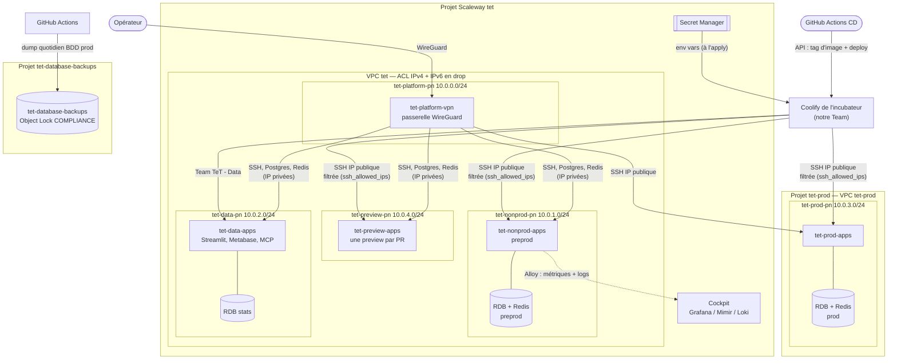
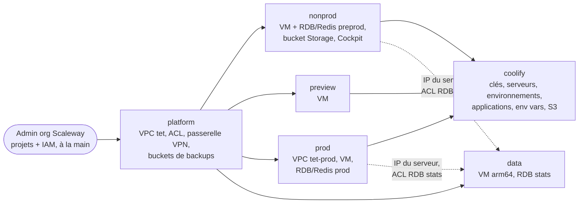

# `infra/` — Infrastructure as Code Scaleway

Terraform qui décrit l'infrastructure TET sur Scaleway : la cible de la migration depuis
Supabase Cloud + Koyeb (cf. [brainstorm de référence](../doc/plans/2026-05-15-001-migration-infra-supabase-koyeb-vers-scaleway-coolify.md)).

**En bref** : l'instance **Coolify de l'incubateur**, où nous avons notre propre Team,
déploie les applications sur trois serveurs applicatifs (prod, nonprod, preview). Un
quatrième, `tet-data-apps` (stack d'analyse), vit dans une Team Coolify à part, « TeT - Data ».
Terraform crée les serveurs, réseaux et bases, puis configure notre Team Coolify
(« Coolify-as-code »). Les opérateurs passent par un **VPN WireGuard**. Les secrets fournis
par un humain vivent dans **Secret Manager**. Ceux que Terraform génère ou lit pour les
injecter sont aussi dans le state : accéder au bucket `tet-tfstate` vaut accès à eux (cf.
[Secrets à déposer](#secrets-à-déposer-à-la-main)).

Procédures ponctuelles (restauration de base, bascule de prod) : [`RUNBOOKS.md`](RUNBOOKS.md).

## Vue d'ensemble



Non dessinés : les utilisateurs arrivent en HTTPS sur le Traefik de chaque serveur, et les
serveurs tirent leurs images de `ghcr.io`.

| Serveur            | Projet         | Rôle                                                     |
| ------------------ | -------------- | -------------------------------------------------------- |
| `tet-platform-vpn` | `tet`          | Passerelle WireGuard des opérateurs. Aucune application. |
| `tet-prod-apps`    | **`tet-prod`** | Applications de production.                              |
| `tet-nonprod-apps` | `tet`          | Preprod (et aldo preprod).                               |
| `tet-preview-apps` | `tet`          | Previews éphémères, une par pull request.                |
| `tet-data-apps`    | `tet`          | Stack d'analyse (Team Coolify « TeT - Data »). arm64.    |

| Environnement | Postgres / Redis              |
| ------------- | ----------------------------- |
| prod          | managés Scaleway (RDB, Redis) |
| preprod       | managés Scaleway (RDB, Redis) |
| preview       | conteneurs Coolify, éphémères |
| data          | RDB managé Scaleway (stats), sans Redis |

Preprod est sur du managé pour rester **iso-prod** : l'admin RDB Scaleway n'est pas
superuser, d'où `scaleway_rdb_user.supabase_auth_admin`, le rôle `postgres` NOLOGIN factice
et `pgcrypto` commenté dans
[`nonprod/supabase-api/sql/001-bootstrap-auth-roles.sql`](nonprod/supabase-api/sql/001-bootstrap-auth-roles.sql).
Un Postgres conteneurisé, superuser, masquerait cette classe de bug jusqu'à la production.

Sur chaque serveur applicatif tournent, déployés par Coolify : `app`, `backend`, `site`,
`supabase-api` (GoTrue + Storage, [`nonprod/supabase-api/`](nonprod/supabase-api/)) et
l'agent Alloy. Pour l'instant, seule la preprod est ouverte (`application_environments`).

## Réseau

Deux VPC **sans aucun lien** : `tet` (projet principal, un Private Network par tier hors
prod) et `tet-prod` (un seul Private Network avec serveur, Postgres et Redis de prod).
`10.0.2.0/24` est le Private Network du tier data (VM data, RDB stats), sans route vers
nonprod. La RDB stats a en plus un endpoint public, fermé par ACL aux seuls serveurs
applicatifs dont le backend la lit (cf. [Tier data](#tier-data-team--tet---data-)).

- **Coolify** (instance de l'incubateur, hors de nos VPC) joint chaque serveur en SSH sur
  son **IP publique**. Le port 22 n'y est ouvert qu'aux `ssh_allowed_ips` du stack du tier :
  l'IP de sortie de l'instance de l'incubateur et celle de la passerelle VPN. Si l'une
  change, réappliquer les quatre stacks de tier.
- **Opérateurs** : par le VPN (cf. [Accès aux serveurs](#accès-aux-serveurs-vpn)). Dans le
  VPC `tet`, les ACL (IPv4 **et** IPv6) n'autorisent que la passerelle VPN vers nonprod,
  preview et data, en TCP 22, 5432 et 6379.
- La prod n'a **aucune route** depuis ce VPC : le VPN la joint sur son IP publique, comme
  Coolify. Une erreur d'ACL côté nonprod, preview ou data ne peut donc pas ouvrir la prod.
- Le trafic intra-PN (app → Postgres/Redis) n'est pas filtré : il reste en L2.

> Les Security Groups Scaleway ne filtrent que l'**interface publique** ; les ACL du VPC
> sont le seul contrôle du trafic privé. Chaque Private Network reçoit d'office un /64
> IPv6 non désactivable, et Scaleway tient une ACL par version d'IP : l'ACL IPv6 refuse
> tout. Sans elle, l'IPv6 serait routé librement et la prod redeviendrait joignable.

Le plan d'adressage est dans `platform/variables.tf` (`network_plan`) et
`prod/variables.tf`. Nonprod, preview et data redéclarent l'IP de leur serveur dans
`server_private_ipv4_address` : **les deux doivent rester alignés**.

## Stacks Terraform



Ordre d'application : `platform → nonprod / prod / preview → coolify`, puis `data`.

- **Un state par stack**, dans le bucket `tet-tfstate`, avec locking natif
  (`use_lockfile`, cf. [Bootstrap](#bootstrap-une-fois)).
- **Liens entre stacks par data sources**, jamais par `terraform_remote_state` ni par
  report manuel d'outputs : chaque stack lit sur l'infra réelle ce que le précédent a créé
  (Private Network, IP de la passerelle VPN, serveurs), par les noms qu'imposent les
  modules (`tet-<tier>-pn`, `tet-<tier>-apps`, `tet-platform-vpn`). Ce qui n'existe que
  dans un state est publié dans Secret Manager : la clé d'hôte SSH des serveurs
  (`tet-<tier>-server-sshd-host-public-key`), lue par `coolify`.
- **`data` après les tiers qu'il autorise** : il lit l'IP publique des serveurs de
  `pg_public_reader_tiers` (nonprod, prod) pour l'ACL de la RDB stats. La lecture est
  stricte, sans variable de secours : serveur absent ou en cours de recréation, `data` ne
  se planifie plus, même pour un changement sans rapport. Le temps de le recréer, retirer
  le tier de `pg_public_reader_tiers` (s'il est le dernier, supprimer d'abord l'endpoint,
  cf. [Flux entre la prod et le tier data](#flux-entre-la-prod-et-le-tier-data)).
- **Une seule flèche à rebours** : `platform` lit les IP publiques des serveurs
  applicatifs pour les router dans le tunnel. La lecture est souple (liste vide si les
  serveurs n'existent pas, avec un avertissement du bloc `check`) : sur une infra vide,
  réappliquer `platform` après les stacks de tier.
- **Passerelle VPN absente** : les stacks de tier ne se planifient plus (ils lisent son IP).
  En secours, passer son IP à la main : `terraform plan -var vpn_public_ip=<IP>`.
- **`terraform.tfvars` versionné** : il ne porte aucun secret (ceux-ci arrivent par
  `TF_VAR_` ou Secret Manager). Les clés SSH des opérateurs y sont, commentées
  `prenom.nom` (pas d'e-mail). Aucune valeur propre au poste : la base preprod se joint par
  le VPN, sans endpoint public.
- `coolify` a son propre state parce qu'il suppose Coolify **déjà joignable** : le `plan`
  de l'infra Scaleway n'exige pas que l'application tourne.

```
infra/
├── modules/             network, vpn, app-server, postgres, redis, cockpit,
│                        cockpit-dashboards
├── platform/            socle transverse
├── nonprod/ prod/ preview/   un stack par tier (nonprod porte aussi supabase-api/ et Cockpit)
├── data/                serveur data (arm64) + RDB stats, rôles MCP (lecture seule) et Metabase ;
│                        s'enregistre lui-même dans la Team Coolify « TeT - Data » (coolify.tf)
├── coolify/             Coolify-as-code
├── observability/       config Alloy + règles d'alerte
└── scripts/             helpers à sourcer (tf-env.sh, coolify-env.sh) et scripts d'API Coolify
```

## Démarrer

### Prérequis

- **Terraform >= 1.10** (pour `use_lockfile`), `scw`, [`aws`](https://www.scaleway.com/en/docs/object-storage/api-cli/object-storage-aws-cli/#how-to-install-the-aws-cli),
  `jq`, `curl`, `ssh`, `psql`, et `wireguard-tools` (`wg`, `wg-quick`) pour le VPN.
- Un compte Scaleway configuré : `brew install scw && scw init`.

### Prérequis admin (organisation Scaleway)

Créer un projet ou une application IAM exige des droits d'organisation, que les
credentials Terraform n'ont pas. Un admin crée donc, une fois :

1. **Trois projets** : `tet` (principal), `tet-prod` et `tet-database-backups`. Leurs
   IDs vont dans `main_project_id`, `prod_project_id` et `database_backups_project_id` de
   `platform/terraform.tfvars`.
2. **Les droits des opérateurs Terraform** sur ces projets :
   - `tet-prod` : serveur, VPC, IPAM, RDB, Redis, secrets et DNS. Le plus simple :
     `AllProductsFullAccess` limité à ce projet ;
   - `tet-database-backups` : `ObjectStorageFullAccess` limité à ce projet. Le verrou COMPLIANCE empêche quand même toute suppression de version avant
     l'échéance.
3. **L'application IAM `tet-database-backups`**, pour les dumps de la BDD de prod faits par
   GitHub Actions :
   - une politique limitée à `tet-database-backups`, avec `ObjectStorageBucketsRead`,
     `ObjectStorageObjectsRead`, `ObjectStorageObjectsWrite` et
     `ObjectStorageObjectsDelete`. Surtout pas `BucketsWrite` : la clé ne doit toucher ni
     le cycle de vie, ni le verrou, ni la politique du bucket ;
   - une clé d'API dont le **projet par défaut est `tet-database-backups`** (l'API S3 résout
     les buckets dans le projet par défaut de la clé). Sa clé va dans
   l'environnement GitHub `prod` (cf. [Backups de la BDD de prod](#backups-de-la-bdd-de-prod)).
4. **Pour `infra/prod`** (bucket de rencontres, [`prod/rencontres.tf`](prod/rencontres.tf)) :
   - le groupe IAM `tet-admin`, avec pour membres **toutes** les identités qui appliquent
     `infra/prod` : ce sont les seules autorisées par les bucket policies de `tet-prod`
     (cf. [Buckets de `tet-prod`](#buckets-de-tet-prod--une-bucket-policy-par-bucket)) ;
   - pour ces mêmes identités, sur l'organisation : `IAMGroupReadOnly` (chaque plan lit le
     groupe) et `IAMApplicationManager` (l'apply crée l'application
     `tet-prod-rencontres-storage` et sa clé). Pas `IAMManager`, qui donne aussi la main sur
     les politiques et les projets. Sans ces droits, tout plan de `infra/prod` échoue en
     403, pas seulement rencontres ;
   - sur l'application `tet-prod-rencontres-storage`, une fois créée par l'apply : une
     politique limitée à `tet-prod`, avec `ObjectStorageObjectsWrite` seulement.

### Bootstrap (une fois)

Le bucket de state doit exister avant le premier `terraform init`, avec versioning **et**
Object Lock : ce dernier active les conditional writes S3 (`If-None-Match: *`) dont dépend
`use_lockfile`. Un plan ou apply concurrent échoue alors immédiatement.

```sh
scw object bucket create name=tet-tfstate region=fr-par enable-versioning=true

aws s3api put-object-lock-configuration \
  --endpoint-url https://s3.fr-par.scw.cloud \
  --bucket tet-tfstate \
  --object-lock-configuration '{
    "ObjectLockEnabled": "Enabled",
    "Rule": { "DefaultRetention": { "Mode": "GOVERNANCE", "Days": 30 } }
  }'
```

### Appliquer un stack

Avant le premier apply de `platform`, déposer `tet-platform-vpn-private-key` (cf.
[VPN](#mise-en-place-une-fois)) : le stack la lit et échoue sans elle.

```sh
# `source`, pas exécuter : sinon les exports se perdent dans le sous-shell
source infra/scripts/tf-env.sh

cd infra/platform
terraform init
terraform plan -out=tfplan
terraform apply tfplan
```

[`scripts/tf-env.sh`](scripts/tf-env.sh) lit `scw config` et exporte `AWS_*` (backend S3),
`SCW_*` (provider) et `TF_VAR_scaleway_secret_key` (provider Grafana). Il **retire**
`SCW_DEFAULT_PROJECT_ID` : le provider le préférerait au `project_id` de chaque stack.

Les stacks applicatifs lisent ce que `platform` a créé (Private Network, IP de la
passerelle VPN, ajoutée d'office à `ssh_allowed_ips`) : rien à reporter.

Sur une infra vide, une fois les stacks applicatifs appliqués, réappliquer `platform` : il
ajoute alors les IP publiques des serveurs aux routes du tunnel. Mettre ensuite à jour
`AllowedIPs` dans la configuration WireGuard de chaque opérateur
(`vpn_client_allowed_ips`, une entrée par pair) : sans cela, le tunnel ne relaie pas les IP publiques des
serveurs.

Après le premier apply d'un stack applicatif, récupérer les mots de passe générés
(`terraform output -raw pg_admin_password`, `redis_admin_password`,
`supabase_auth_admin_password`) et les ranger dans Secret Manager.

Pour le stack `coolify`, sourcer en plus `scripts/coolify-env.sh` (`COOLIFY_ENDPOINT`,
`COOLIFY_TOKEN`), après avoir [créé le token](#instance-coolify-de-lincubateur) et
[déposé ses secrets](#secrets-à-déposer-à-la-main), et se connecter au VPN. Le stack `data`
le source aussi, pour le token de la Team « TeT - Data » (`TF_VAR_coolify_data_token`).

### Hygiène

```sh
terraform fmt -recursive
for lock in */.terraform.lock.hcl; do
  d=$(dirname $lock)
  terraform -chdir=$d init -backend=false && terraform -chdir=$d validate
done
tflint --recursive
```

Le `.terraform.lock.hcl` de chaque stack est versionné : il fige les versions des providers.

## Accès aux serveurs (VPN)

Les opérateurs passent par une passerelle **WireGuard** (`tet-platform-vpn`, module
[`modules/vpn`](modules/vpn)). Le tunnel relaie le VPC `tet` (SSH, Postgres et Redis de
nonprod et preview, filtrés par l'ACL) et les IP publiques des serveurs (lues par `platform`),
dont la prod. La passerelle masque ses clients derrière son IP : les serveurs, l'ACL et
les security groups ne voient qu'elle.

La passerelle n'a pas d'état : changer un pair ou une route **remplace la VM** (une à deux
minutes de coupure du tunnel). Son IP publique, sa clé WireGuard (Secret Manager) et sa clé
d'hôte SSH survivent au remplacement : les postes n'ont rien à changer.

Chaque serveur a **sa propre clé SSH root** (`tet-<tier>-server-ssh-key` dans Secret
Manager) : révoquer un serveur compromis ne casse pas les autres.

### Mise en place (une fois)

```sh
# Clé de la passerelle, déposée à la main : elle ne doit pas changer avec la VM
wg genkey | scw secret version create \
  "$(scw secret secret create name=tet-platform-vpn-private-key project-id=<projet-principal> -o json | jq -r .id)" \
  data=@/dev/stdin
```

### Ajouter un opérateur

1. Sur son poste : `(umask 077 && wg genkey | tee tet.key | wg pubkey)`. `tet.key` est sa
   clé privée, lisible par lui seul ; la ligne affichée est la publique.
2. Dans `platform/terraform.tfvars`, ajouter
   `"<prenom.nom>" = { public_key = "<publique>", address = "10.99.0.<n>" }` à `vpn_peers`
   et, s'il doit administrer la passerelle (`ssh tet-ops@10.99.0.1`), sa clé SSH publique à
   `vpn_ssh_authorized_keys`. Appliquer `platform`, puis ajouter la même clé à
   `server_ssh_authorized_keys` des stacks `nonprod`, `preview`, `prod` et `data` pour
   qu'il accède aux serveurs.

   Accès restreint (ex. le data analyst) : `tiers = ["data"]` dans son entrée. La
   passerelle ne lui relaie que le Private Network et l'IP publique des serveurs de ces
   tiers et jette le reste : ni la prod, ni la preprod (qui porte une copie des données de
   prod). Sa clé SSH ne va alors que dans les stacks de ses tiers.
3. Sa configuration (`/etc/wireguard/tet.conf`, ou l'app WireGuard) :

```ini
[Interface]
PrivateKey = <contenu de tet.key>
Address = 10.99.0.<n>/32

[Peer]
# scw secret version access-by-path secret-name=tet-platform-vpn-private-key secret-path=/ \
#   revision=latest -o json | jq -r .data | base64 -d | wg pubkey
PublicKey = <publique de la passerelle>
Endpoint = <terraform -chdir=infra/platform output -raw vpn_endpoint>
AllowedIPs = <terraform -chdir=infra/platform output -json vpn_client_allowed_ips | jq -r '."<prenom.nom>"'>
PersistentKeepalive = 25
```

Retirer un opérateur : supprimer son entrée de `vpn_peers` et, s'il administrait la
passerelle, sa clé de `vpn_ssh_authorized_keys` et toute IP de secours qui lui est propre
dans `vpn_ssh_allowed_ips`. Appliquer `platform`.

### Se connecter

Épingler une fois les clés d'hôte, générées par Terraform, plutôt que d'accepter la
première venue. Commandes à lancer depuis la racine du dépôt :

```sh
{
  for t in nonprod preview prod data; do
    echo "$(terraform -chdir=infra/$t output -raw server_public_ip) $(terraform -chdir=infra/$t output -raw server_sshd_host_public_key)"
  done
  echo "$(terraform -chdir=infra/platform output -raw vpn_gateway_tunnel_ip) $(terraform -chdir=infra/platform output -raw vpn_sshd_host_public_key)"
} >> ~/.ssh/known_hosts
```

Un « REMOTE HOST IDENTIFICATION HAS CHANGED » n'est jamais anodin : soit le serveur a été
recréé (mettre à jour la ligne), soit la connexion est interceptée.

Sur macOS, l'app WireGuard du Mac App Store remplace `wg-quick` :
importer `tet.conf` (« Import tunnel(s) from file ») donne une icône
dans la barre des menus, qui montre l'état du tunnel et le bascule sans `sudo`.
Ne pas faire tourner les deux à la fois (`sudo wg-quick down tet` avant l'import).

```sh
wg-quick up tet

# Un serveur, en root avec sa clé (prod : ajouter project-id=<projet tet-prod>).
# mktemp crée le fichier en 600 ; l'effacer en fin de session.
KEY="$(mktemp)"
scw secret version access-by-path \
  secret-name="$(terraform -chdir=infra/nonprod output -raw server_ssh_key_secret_name)" \
  secret-path=/ revision=latest -o json | jq -r '.data' | base64 -d > "$KEY"
ssh -i "$KEY" root@$(terraform -chdir=infra/nonprod output -raw server_public_ip)
rm -f "$KEY"

# Postgres preprod, en direct sur son IP privée
psql "host=$(terraform -chdir=infra/nonprod output -raw pg_private_endpoint_ip) …"

# La passerelle elle-même
ssh tet-ops@10.99.0.1
```

Tunnel tombé : `vpn_ssh_allowed_ips` ouvre en secours le 22 public de la passerelle à une
IP donnée, sinon console Scaleway.

Contrôle d'isolation, depuis le serveur nonprod : `nc -zv -w3 10.0.3.10 22` et
`nc -zv -w3 <ip-publique-prod> 22` doivent tous deux finir en timeout.

## Coolify

### Instance Coolify de l'incubateur

Nous n'administrons pas l'instance : son admin en gère la version, les réglages, le proxy
de son propre serveur et la sauvegarde. Nous avons une **Team** dédiée, dont nous sommes
admins, et tout ce que décrit le stack `coolify` vit dans cette Team.

1. Dans notre Team, **Security → API Tokens** → créer un token **scope `root`** (limité à
   la Team) et le ranger dans Secret Manager (cf. ci-dessous). Idem dans la Team
   « TeT - Data » (cf. [Tier data](#tier-data-team--tet---data-)).
2. `coolify_endpoint` dans `coolify/terraform.tfvars` : `https://<instance>/api/v1`.
3. L'IP de sortie de l'instance, fournie par son admin, va dans `ssh_allowed_ips` des
   stacks `nonprod`, `preview`, `prod` et `data`. Elle doit rester fixe.

Les admins de l'instance peuvent lire ce que contient notre Team, clés SSH root et
variables d'environnement comprises. C'est le prix de la mutualisation, à garder en tête
avant d'y confier un secret qui ne sert pas aux applications.

### Secrets à déposer à la main

Ces secrets ne sont jamais créés par Terraform avec leur valeur. Tous dans le projet
principal. `tet-platform-vpn-private-key` passe pourtant en clair par le state de
`platform`, qui la lit pour l'injecter dans le `user_data` de la passerelle.

Le state contient aussi tout ce que Terraform génère : clés SSH root et clés d'hôte des
serveurs et de la passerelle (`tls_private_key`), mots de passe des bases
(`random_password`). Les droits sur `tet-tfstate` sont donc ceux d'un accès root aux
serveurs : à réserver aux opérateurs Terraform.

| Secret                                | Format                       | Contenu                                                                                           |
| ------------------------------------- | ---------------------------- | ------------------------------------------------------------------------------------------------- |
| `tet-platform-coolify-api-token`      | `<id>\|<token>`              | Token API `root` de notre Team Coolify (créé dans l'UI)                                           |
| `tet-platform-coolify-data-api-token` | `<id>\|<token>`              | Token API `root` de la Team Coolify « TeT - Data » (créé dans l'UI)                               |
| `tet-platform-vpn-private-key`        | sortie de `wg genkey`        | Clé privée WireGuard de la passerelle (cf. [VPN](#mise-en-place-une-fois))                        |
| `tet-platform-ghcr-pull`              | `<github-username>\|<pat>`   | PAT GitHub **classic**, scope `read:packages` seul, idéalement sur un machine user                |

```sh
# Créer le secret s'il n'existe pas (api-token, ghcr-pull)…
_id="$(scw secret secret create name=<nom> project-id=<projet-principal> -o json | jq -r .id)"
# …ou le retrouver
_id="$(scw secret secret list name=<nom> project-id=<projet-principal> -o json | jq -r '.[0].id')"
printf '%s|%s' '<partie-1>' '<partie-2>' | scw secret version create "$_id" data=@/dev/stdin
```

- **GHCR** : pas de PAT fine-grained, GHCR ne les accepte pas (`docker login` réussit mais
  tout pull répond `denied`). Si l'org impose le SSO, autoriser le PAT. Vérification :
  `curl -sI -H "Authorization: token <pat>" https://api.github.com/user | grep -i x-oauth-scopes`.
  Coolify n'a pas d'API pour ça :
  [`scripts/coolify-ghcr-docker-login.sh`](scripts/coolify-ghcr-docker-login.sh) écrit
  `/root/.docker/config.json` sur chaque serveur, en SSH : appliquer `coolify` connecté au VPN.
- **Rotation** : déposer une nouvelle version du secret, incrémenter
  `ghcr_pull_credentials_revision` dans `coolify/terraform.tfvars`, appliquer `coolify`.

### Ce que gère le stack `coolify`

Via le provider [`coolify-terraform/coolify`](https://registry.terraform.io/providers/coolify-terraform/coolify)
et, là où il ne convient pas, des scripts d'API dans `scripts/` :

| Quoi                                       | Comment                                                                           |
| ------------------------------------------ | --------------------------------------------------------------------------------- |
| Clés SSH, serveurs, projet, environnements | ressources natives (`plan` détecte le drift de l'UI)                              |
| Applications `app`, `backend`, `site`      | `coolify_application_docker_image` ([`applications.tf`](coolify/applications.tf)) |
| Outils internes (`mailpit`)                | idem, sans CD : à redéployer à la main (cf. ci-dessous)                           |
| Services `supabase-api` et Alloy           | `coolify_service` ([`services.tf`](coolify/services.tf))                          |
| Variables d'environnement                  | script `coolify-push-env.sh`                                                      |
| Login GHCR sur les serveurs                | script `coolify-ghcr-docker-login.sh`                                             |

Env vars et GHCR restent en scripts par choix : le provider stocke tout secret qu'il
gère dans le state (aucun attribut write-only), et son API « bulk » d'env vars ignore
`is_multiline`/`is_literal`. Les scripts lisent Secret Manager à l'apply et n'écrivent rien
dans le state. À revisiter si le provider gagne des attributs `*_wo`.

> ⚠️ `coolify_server` et `coolify_environment` suppriment **en cascade** (applications et
> bases comprises) et portent donc `prevent_destroy`. Retirer un serveur ou un
> environnement se fait en deux temps : `terraform state rm`, puis suppression dans l'UI,
> qui refuse tant qu'il reste des ressources dessus.

Vérifier que Coolify voit ses serveurs :

```sh
curl -sH "Authorization: Bearer $COOLIFY_TOKEN" "$COOLIFY_ENDPOINT/servers" | jq -r '.[] | "\(.name) \(.ip)"'
```

### Déploiement des applications

Terraform déclare les applications (image, domaines, port, healthcheck) mais **ne possède
pas le tag d'image** : il ne le pose qu'à la création, puis l'ignore. C'est la CD
(`.github/workflows/cd-preprod.yml` pour la preprod) qui choisit la version. La prod ne
construit rien : `cd-prod.yml` promeut l'image qui tourne en preprod, vérifiée par son
attestation et déployée par digest (tag Coolify `sha256-<hex>`). À la main :

```sh
APP_ID=preprod/app IMAGE_TAG=<sha> infra/scripts/coolify-deploy.sh
```

Les outils internes (`mailpit`) n'ont pas de CD et Terraform ne les déploie pas : après
leur création, un changement de tag ou de variables, lancer
`APP_ID=preprod/mailpit infra/scripts/coolify-deploy.sh`.

Les scripts retrouvent chaque application par le marqueur `(tet-app=<env>/<app>)` de sa
description (`(tet-service=…)` pour un service, `(tet-server=…)` pour un serveur) : la CD
n'a besoin d'aucun UUID. Coolify ≥ 4.7 refuse `[ ] :` dans une description, d'où ce format.
Les environnements s'ouvrent un par un via `application_environments` (défaut
`["preprod"]`). Retirer une application du catalogue ne la supprime pas de Coolify. Feuille de route :
[`doc/plans/2026-10-06-001-infra-applications-coolify-as-code-plan.md`](../doc/plans/2026-10-06-001-infra-applications-coolify-as-code-plan.md).

### Applications Git (aldo, rencontres)

Les produits voisins, chacun dans son dépôt public, sont déclarés dans
[`coolify/git-applications.tf`](coolify/git-applications.tf) : Coolify clone la branche et
construit l'image sur le serveur cible (Railpack). Ils ont leurs propres domaines, donc ne
suivent pas `application_environments`. Variables : même manifeste que les autres
(`env-manifest.tf`).

Mise en service d'une entrée :

1. `terraform apply` : il crée l'application et les coquilles de secrets, puis échoue sur
   `env_push` (« secret sans version »), ce qui est attendu. Déposer les secrets listés par
   `env_manual_secrets` (`SECRET_PROJECT_ID=<projet tet-prod>` pour la prod), puis
   réappliquer : l'`env_push` en échec est rejoué, sans toucher à `coolify_env_revision`.
2. Premier déploiement : bouton **Deploy** dans Coolify, ou
   `APP_ID=<env>/<app> infra/scripts/coolify-deploy.sh` (sans `IMAGE_TAG` : tête de branche).
3. Redéploiement au push : dans le dépôt GitHub, **Settings → Webhooks** →
   `https://<instance>/webhooks/source/github/events/manual`,
   `application/json`, événement _push_, avec le secret de l'onglet **Webhooks** de
   l'application dans Coolify. Retirer ensuite l'auto-deploy du service Koyeb.
4. Domaine hors `*.preprod` : le déclarer d'abord en `http://<nom>`. Avec `https://`,
   Traefik tenterait un certificat Let's Encrypt sur un nom qui pointe encore vers Koyeb, et
   les échecs répétés peuvent bloquer l'émission après la bascule. Vérifier avec
   `curl --resolve <nom>:80:<ip du serveur> http://<nom>/`, passer chez Cloudflare le CNAME
   Koyeb en A vers le serveur (DNS only), puis déclarer `https://<nom>`, appliquer et
   redéployer : Traefik émet le certificat dans la minute. Redéployer aussi le service
   Alloy du serveur (`<env>/alloy`, bouton **Redeploy** dans Coolify) : il ne relit
   `PROBE_TARGETS`, qui gagne la sonde HTTPS de l'application, qu'au démarrage. Mettre le
   service Koyeb en pause une fois le trafic basculé.

### Tier data (Team « TeT - Data »)

`tet-data-apps` vit dans une Team Coolify à part, « TeT - Data », où le data analyst
déploie lui-même Streamlit, Metabase, le serveur MCP et les scripts de calcul. Notre Team
porte la prod, et Coolify donne ses droits par Team : l'y inviter lui ouvrirait tout. Le
stack `data` y enregistre lui-même la clé et le serveur
([`data/coolify.tf`](data/coolify.tf)), avec le token de cette Team : le stack `coolify`,
qui porte la prod, ne dépend ni de ce token ni de la VM data. Pas de login GHCR, que le
terminal root de la Team exposerait. Contrepartie : le `plan` de `data` suppose Coolify
joignable et ce token valide.

Mise en place, une fois :

1. Dans la Team « TeT - Data », **Security → API Tokens** : token **scope `root`**, rangé
   dans `tet-platform-coolify-data-api-token` (cf.
   [Secrets à déposer à la main](#secrets-à-déposer-à-la-main)).
2. `source infra/scripts/coolify-env.sh`, puis `terraform -chdir=infra/data apply`.
3. Inviter le data analyst : **Teams → Members**, par e-mail ou lien d'invitation. Le
   provider n'a pas de ressource pour les membres.
4. Accès VPN du data analyst : pair à accès restreint, `tiers = ["data"]` (cf.
   [Ajouter un opérateur](#ajouter-un-opérateur)).
5. Les URIs des rôles (`stats_writer_private_connection_uri`,
   `mcp_reader_private_connection_uri`, `metabase_private_connection_uri`) se collent dans
   les variables des ressources Coolify concernées.

#### Flux entre la prod et le tier data

Aucune connexion ne part du tier data vers la prod : le data analyst, autonome sur son
serveur, ne détient aucun identifiant qui l'ouvre. Les deux flux partent de la prod.

```
 prod                                  bucket                      tier data
 RDB ── export filtré, chaque nuit ──► tet-analytics-export ◄── tet-data-apps
 site ──► backend ── TLS vérifié, IP autorisée ──────────────► tet-stats-pg (endpoint public + ACL)
```

**Export de la prod.** Le job `export-analytics` de `.github/workflows/backup-database.yml`
([`analytics-export.sh`](../data_layer/backup/analytics-export.sh)) dépose chaque nuit un
export filtré dans le bucket `tet-analytics-export`
([`data/analytics-export.tf`](data/analytics-export.tf)), que le serveur data télécharge.

**Lecture de la base de stats par les backends.** `pg_public_reader_tiers`
([`data/terraform.tfvars`](data/terraform.tfvars)) pose sur la RDB une ACL qui n'autorise
que l'IP publique des serveurs listés, et `pg_public_endpoint_enabled` ouvre l'endpoint
public qu'elle filtre. Le backend s'y connecte en `backend_reader` (lecture seule, rôle à
part de celui du MCP) et vérifie le certificat avec la CA de l'instance ; le site ne s'y
connecte pas, il demande ses chiffres au backend.

Première ouverture, en deux applies : le provider crée l'endpoint avant l'ACL, et un apply
interrompu entre les deux le laisserait sans filtre.

```sh
# 1. L'ACL seule, puis la vérifier : les serveurs listés, jamais 0.0.0.0/0.
terraform -chdir=infra/data apply -var pg_public_endpoint_enabled=false
PG_ID="$(terraform -chdir=infra/data output -raw pg_instance_id | cut -d/ -f2)"
scw rdb acl list instance-id="$PG_ID"

# 2. L'endpoint, puis revérifier l'ACL.
terraform -chdir=infra/data apply
scw rdb acl list instance-id="$PG_ID"

# 3. L'URI et la CA, toujours ensemble : l'URI ne porte pas de sslmode (le backend le
#    refuse quand une CA est fournie), sans la CA la connexion partirait en clair.
#    Leurs coquilles viennent de infra/coolify (env-manifest.tf).
terraform -chdir=infra/coolify apply \
  -target='scaleway_secret.coolify_env_manual["preprod/analytics-database-url"]' \
  -target='scaleway_secret.coolify_env_manual["preprod/analytics-database-tls-ca"]'
terraform -chdir=infra/data output -raw backend_reader_public_connection_uri \
  | infra/scripts/coolify-env-secret-set.sh preprod analytics-database-url
terraform -chdir=infra/data output -raw pg_tls_ca \
  | infra/scripts/coolify-env-secret-set.sh preprod analytics-database-tls-ca
```

Si le backend refuse le certificat sur l'IP de l'endpoint public, le renouveler pour qu'il
porte ce nouvel endpoint. L'ancien certificat cesse de valoir : `terraform output` lit le
state, à rafraîchir avant de redéposer la CA, et les conteneurs du tier data qui épinglent
l'ancienne la reçoivent aussi.

```sh
scw rdb instance renew-certificate "$PG_ID"
terraform -chdir=infra/data apply -refresh-only
terraform -chdir=infra/data output -raw pg_tls_ca \
  | infra/scripts/coolify-env-secret-set.sh preprod analytics-database-tls-ca
```

Tant que le backend de prod tourne sur Koyeb, dont les IP de sortie ne sont pas fixes, il
ne peut pas être autorisé : la base Koyeb reste sa source jusqu'à sa bascule. Ajouter
alors `prod` à `pg_public_reader_tiers`.

Fermer l'endpoint : Terraform ne le supprime pas (le provider ignore le retrait du bloc).
Le supprimer à la main, puis seulement passer `pg_public_endpoint_enabled` à `false` et
vider `pg_public_reader_tiers` : tant que l'endpoint existe, le plan refuse de retirer
son ACL.

```sh
scw rdb endpoint list "$PG_ID"   # l'endpoint qui porte un load_balancer
scw rdb endpoint delete <endpoint-id> instance-id="$PG_ID"
```

**Miroir de la prod (schéma `prod` de `stats`).** Copie complète à J-1, pas une
réplication : une réplication logique ou un `postgres_fdw` demanderaient au tier data une
connexion vers la prod, et la première ferait grossir le WAL de la prod à chaque
migration non rejouée côté miroir.

1. Le job `export-analytics` de `.github/workflows/backup-database.yml`
   ([`analytics-export.sh`](../data_layer/backup/analytics-export.sh)) dépose l'export dans
   `tet-analytics-export`. Le filtre est à la source : données des seuls schémas listés
   dans le script, sans les tables de secrets, et `auth.users` réduit à quelques colonnes
   (ni hash, ni jeton, ni téléphone).
2. [`prod-mirror/refresh-prod-mirror.sh`](data/prod-mirror/refresh-prod-mirror.sh), sur
   `tet-data-apps`, restaure l'export dans une base de travail, y construit les tables
   `prod.<schéma>_<table>` (types de la prod ramenés à des types standards, sans index ni
   contrainte) et bascule le schéma en une transaction.

Mise en place, une fois :

1. Faire créer par un admin de l'organisation deux applications IAM, avec le droit objets
   sur le projet `tet` : l'une dépose (job de backup), l'autre télécharge (serveur data).
   Renseigner `analytics_export` dans `data/terraform.tfvars` et appliquer : la bucket
   policy cantonne chacune à ce bucket et à son sens.
2. Environnement GitHub `prod` : variables `ANALYTICS_EXPORT_BUCKET` (output
   `analytics_export_bucket_name`) et `ANALYTICS_EXPORT_AWS_ACCESS_KEY_ID`, secret
   `ANALYTICS_EXPORT_AWS_SECRET_ACCESS_KEY`. Sans `ANALYTICS_EXPORT_BUCKET`, le job est sauté.
3. Sur `tet-data-apps`, construire l'image et planifier le job après l'export (22 h UTC) :

```sh
docker build -t prod-mirror infra/data/prod-mirror
# /root/prod-mirror.env (600) : STATS_DB_URL (output pg_private_connection_uri),
# EXPORT_BUCKET, EXPORT_ACCESS_KEY, EXPORT_SECRET_KEY.
echo '0 2 * * * root docker run --rm --env-file /root/prod-mirror.env prod-mirror >> /var/log/prod-mirror.log 2>&1' \
  > /etc/cron.d/prod-mirror
```

Le job échoue sans rien changer si l'export est incomplet, s'il perd plus de 10 % des
tables, ou si une vue de `public` dépend de l'ancien miroir : une vue sur `prod.*` se
recrée après chaque bascule, ou se remplace par une table que les scripts recalculent.

Reprise de la base de stats depuis Koyeb : le dump passe par le serveur data, qui sort sur
internet et joint la RDB en privé. Seuls les schémas `public` (stats) et `sauvegardes`
sont repris : `prod` est reconstruit par le miroir ci-dessus. Arrêter les scripts de
calcul le temps du transfert.

```sh
# Sur tet-data-apps (cf. Se connecter). Source : l'URI Koyeb ; cible : output
# pg_private_connection_uri (admin).
docker run --rm -e SRC -e DST postgres:17 sh -c \
  'pg_dump -Fc --no-owner --no-privileges -n public -n sauvegardes "$SRC" | pg_restore --no-owner --no-privileges -d "$DST"'
```

La base `stats` cible doit être vide. Si le transfert échoue en route, les tables déjà
restaurées restent remplies et une relance telle quelle dupliquerait leurs lignes :
rejouer avec `pg_restore --clean --if-exists`, qui supprime chaque objet avant de le
recréer.

Les droits des rôles (`scaleway_rdb_privilege`) ne couvrent que les tables qui existaient
quand Terraform les a posés : les tables restaurées, possédées par l'admin, et celles que
les scripts créeront ensuite leur échappent. Après la restauration :

```sql
-- En admin (pg_private_connection_uri) : tables restaurées. Le schéma prod reçoit
-- ses droits du miroir, à chaque bascule.
GRANT SELECT ON ALL TABLES IN SCHEMA public TO mcp_reader, backend_reader;
GRANT SELECT, INSERT, UPDATE, DELETE ON ALL TABLES IN SCHEMA public TO stats_writer;
GRANT USAGE, SELECT ON ALL SEQUENCES IN SCHEMA public TO stats_writer;
GRANT USAGE, CREATE ON SCHEMA sauvegardes TO stats_writer;
GRANT SELECT, INSERT, UPDATE, DELETE ON ALL TABLES IN SCHEMA sauvegardes TO stats_writer;

-- En stats_writer (stats_writer_private_connection_uri) : les tables qu'il créera
-- seront lisibles par le MCP et les backends.
ALTER DEFAULT PRIVILEGES IN SCHEMA public GRANT SELECT ON TABLES TO mcp_reader, backend_reader;
```

Le rôle `metabase` n'a accès qu'à la base `metabase` : comme source de données, Metabase
lit `stats` en `mcp_reader`. Vérifier avec `\dp`. Si les scripts doivent créer des tables et que `stats_writer` ne le
peut pas, le dire avant de lui donner plus : c'est un choix de droits, pas un oubli.

### Previews

Une stack complète par pull request labellisée `preview`, créée par la CI via l'API de
Coolify, qui la déploie et la supprime (les _preview deployments_ natifs restent
désactivés) : [`preview/docker-compose.yml`](preview/docker-compose.yml) (app, backend, site,
GoTrue, Storage, Redis, Postgres ; `app.…/api` routé au backend comme en prod), déclaré comme
application compose `stack` (environnement `preview`) dans
[`coolify/preview-application.tf`](coolify/preview-application.tf). La base part de l'image
`supabase_db_tet` de la CI (`_prepare-test-db.yml`), déjà migrée et seedée : copiée dans le
volume de la preview au premier démarrage, supprimée avec elle ; le backend y applique au
démarrage les migrations de la PR.

**Usage** : poser le label `preview` sur une PR (hors brouillon, branche du dépôt).
À chaque push, [`preview-build.yml`](../.github/workflows/preview-build.yml) construit app,
backend et site au commit de tête (images taguées du SHA complet), puis
[`preview-deploy.yml`](../.github/workflows/preview-deploy.yml) crée ou redéploie la preview
à ce commit par l'API Coolify ; le compose prend ses images dans `SOURCE_COMMIT`. URL :
`https://<n>-app.preview.territoiresentransitions.fr`. Fermer la PR supprime la preview
(webhook de la GitHub App) ; retirer le label la laisse en place jusqu'à la fermeture.
Coolify lit le compose sur `main`, pas sur la branche de la PR : une modification de
`preview/docker-compose.yml` ne vaut pour les previews qu'une fois mergée.

Mise en service :

1. `terraform apply -var preview_github_app_uuid=<uuid> -var preview_git_branch=<branche>`
   (UUID : Coolify → Sources → la GitHub App de la Team). La branche doit contenir le
   compose.
2. Dans l'application, onglet **Environment Variables**, poser les variables listées en tête
   du compose, dans le jeu de l'application et dans celui des _Preview Deployments_. Le
   compte de service Google est propre aux previews (lecteur des classeurs, sans Vertex
   AI), avec son dossier Drive de résultats. Secret et clés propres aux previews :

   ```sh
   SECRET=$(openssl rand -hex 32); echo "SUPABASE_JWT_SECRET=$SECRET"
   for role in anon service_role; do node -e '
     const b = (o) => Buffer.from(JSON.stringify(o)).toString("base64url");
     const [secret, role] = process.argv.slice(1), now = Math.floor(Date.now() / 1000);
     const body = b({ alg: "HS256", typ: "JWT" }) + "." + b({ role, iss: "supabase", iat: now, exp: now + 315360000 });
     console.log(role + "=" + body + "." + require("crypto").createHmac("sha256", secret).update(body).digest("base64url"));
   ' "$SECRET" "$role"; done
   ```

3. **Deploy** une première fois : ce déploiement charge le compose, puis échoue faute
   d'images au commit de `main` (attendu). Réappliquer ensuite avec
   les mêmes `-var` qu'à l'étape 1 (sans eux, Terraform détruit l'application) et
   `-var preview_compose_loaded=true`, qui pose les domaines et leur port d'écoute.
4. Onglet **Preview Deployments** : régler _Preview URL Template_ sur `{{pr_id}}-{{domain}}`
   (le défaut `{{pr_id}}.{{domain}}` sort du wildcard DNS `*.preview`). Laisser les previews
   désactivées : c'est la CI qui les crée.
5. Environnement GitHub `preview-scaleway`, restreint à `main` comme `preprod-scaleway` :
   secret `COOLIFY_TOKEN` (write + deploy, jamais root) et variable `COOLIFY_ENDPOINT`. Créer
   le label `preview` dans le dépôt.

À la fermeture d'une PR, Coolify supprime sa preview, mais un `docker rm` en échec n'est que
journalisé. Sur le serveur preview, rien ne doit rester au nom de la PR :

```sh
# Numéro ancré en fin de nom : -pr-12 ne doit pas attraper -pr-123.
PR=<n>
docker ps -a --format '{{.Names}}' | grep -E -- "-pr-$PR\$"
docker volume ls -q | grep -E -- "-pr-$PR\$"
# Noms vérifiés, s'il en reste :
docker ps -a --format '{{.Names}}' | grep -E -- "-pr-$PR\$" | xargs -r docker rm -f
docker volume ls -q | grep -E -- "-pr-$PR\$" | xargs -r docker volume rm
```

### Buckets de `tet-prod` : une bucket policy par bucket

Les permissions IAM Object Storage valent pour un projet entier. `tet-prod` héberge le bucket
de rencontres ([`prod/rencontres.tf`](prod/rencontres.tf)), dont la clé applicative a le
droit IAM d'écriture d'objets sur le projet. **Tout bucket de `tet-prod` se
crée donc par [`modules/bucket`](modules/bucket)**, qui pose la bucket policy avec le bucket
(les déclarations de l'application + les opérateurs) : un bucket sans policy reste ouvert à
toute clé IAM du projet. Une bucket policy fonctionne en liste blanche : toute identité qui
lance `terraform apply` sur `infra/prod` doit être membre du groupe IAM `tet-admin`, d'où
[`prod/main.tf`](prod/main.tf) tire les opérateurs, sinon le refresh du bucket lui renvoie
un 403. Après l'ajout d'un membre, un membre déjà autorisé réapplique `infra/prod`.

### Variables d'environnement (Secret Manager → Coolify)

[`coolify/env-manifest.tf`](coolify/env-manifest.tf) liste, par environnement et par
application, chaque variable : valeur en clair (`value`) ou nom de secret (`secret`), rangé
sous `/coolify-env/<env>/tet-<env>-<nom>`.

| Secret                                             | Coquille créée par                               | Valeur déposée par |
| -------------------------------------------------- | ------------------------------------------------ | ------------------ |
| Dérivés de l'infra (URI Postgres, URI et CA Redis) | stack du tier (`nonprod/coolify-env-secrets.tf`) | Terraform          |
| Applicatifs (clés Supabase, Brevo, Google…)        | `coolify/env-secrets.tf`                         | un opérateur       |

```sh
terraform -chdir=infra/coolify output env_manual_secrets   # ce qui est attendu
infra/scripts/coolify-env-secret-set.sh preprod brevo-api-key < brevo.txt
jq -c . sa.json | infra/scripts/coolify-env-secret-set.sh preprod gcloud-service-account-key
# puis incrémenter coolify_env_revision dans coolify/terraform.tfvars et appliquer
```

[`scripts/coolify-push-env.sh`](scripts/coolify-push-env.sh) résout toutes les valeurs
**avant** d'écrire : un secret manquant fait échouer l'apply sans rien modifier.

- **Le manifeste fait autorité** : `coolify_env_prune = true` (défaut) supprime toute
  variable absente du manifeste, y compris celles ajoutées dans l'UI.
- **Interdits**, bloqués par des préconditions : les clés fournies par l'image
  (`GIT_SHORT_HASH`, `APPLICATION_VERSION`, `NODE_ENV`, `PORT`, `HOSTNAME`…), les
  `NEXT_PUBLIC_*`, et une valeur en clair sur une clé au nom sensible. Toutes les variables
  sont poussées en runtime seulement : un `NEXT_PUBLIC_*` n'atteindrait pas le build.
- **Pousser ne redéploie pas** : redéployer avec `APP_ID=<env>/<app> coolify-deploy.sh`.
  Sans `IMAGE_TAG`, il redéploie la version en place : la même image pour une application
  « image Docker », la tête de branche pour une application Git.
- **Ajouter une clé** : une ligne dans le manifeste. Pour un secret, l'`apply` crée sa
  coquille puis échoue en la signalant vide : déposer la valeur, réappliquer.

### Sauvegarde

La sauvegarde de l'instance revient à son admin. Notre reprise ne dépend pas d'elle : tout
ce que contient notre Team se recrée par `terraform apply` (serveurs, applications,
variables lues dans Secret Manager). Restent à refaire à la main : les webhooks GitHub des
applications Git et les flags de métriques Traefik de chaque serveur.

Pas de S3 storage de backups dans notre Team : preprod et prod sont sur des RDB managées,
et les bases des previews sont jetables.

## Backups de la BDD de prod

Le workflow `.github/workflows/backup-database.yml` dumpe chaque nuit la BDD de prod
(`data_layer/backup/backup.sh`), l'envoie dans le bucket `tet-database-backups` (stack
`platform`), applique la rétention (`cleanup.sh` : tout sur 14 jours, puis 1 par semaine jusqu'à
4 semaines, puis 1 par mois jusqu'à 12 mois) et restaure staging et preprod depuis ce bucket. Object Lock COMPLIANCE
(14 jours).

Variables et secrets de l'environnement GitHub `prod` :

| Nom                            | Type     | Valeur                                             |
| ------------------------------ | -------- | -------------------------------------------------- |
| `BACKUP_BUCKET`                | variable | output `database_backups_bucket_name`              |
| `BACKUP_ENDPOINT_URL`          | variable | output `database_backups_s3_endpoint`              |
| `BACKUP_REGION`                | variable | `fr-par`                                           |
| `BACKUP_AWS_ACCESS_KEY_ID`     | variable | access key de l'application `tet-database-backups` |
| `BACKUP_AWS_SECRET_ACCESS_KEY` | secret   | secret key de la même application                  |

Le bucket a son propre projet, `tet-database-backups` : les permissions IAM Object Storage
valent pour un projet entier, et les dumps ne sont pas chiffrés. Dans un projet partagé,
une autre clé pourrait les lire, ou déposer un faux dump que `restore.sh` restaurerait.

Bascule depuis l'ancien bucket Supabase `prod-backups` : changer ces variables avant le
premier run qui embarque la nouvelle rétention, sinon `cleanup.sh` l'applique à
`prod-backups`. `restore-preprod` restaure le dump de la veille : copier
`backup-<veille>.dump` (et son `.metadata.json`) dans `tet-database-backups` avant le premier
run, ou accepter son échec cette nuit-là. L'historique reste dans `prod-backups`, à garder
jusqu'à ce que le nouveau bucket ait fait ses preuves.

## DNS

Tout reste chez Cloudflare, hors Terraform, en **DNS only** (Traefik émet lui-même ses
certificats en HTTP-01) :

| Nom                                            | Type | Cible                                                         |
| ---------------------------------------------- | ---- | ------------------------------------------------------------- |
| `preprod`, `*.preprod`                         | A    | `terraform -chdir=infra/nonprod output -raw server_public_ip` |
| `preview`, `*.preview`                         | A    | `terraform -chdir=infra/preview output -raw server_public_ip` |

À reporter à la main si un serveur est recréé. Pas de sous-zones déléguées à Scaleway
Domains : un domaine externe dont l'apex ne pointe pas sur les NS de Scaleway y est supprimé
au bout de 14 jours, zones comprises (incident du 2026-10-23). À reconsidérer après la
migration de la prod.

## Observabilité (Cockpit)

Monitoring et alerting passent par **Cockpit** (Grafana/Mimir/Loki managés par Scaleway),
un par projet Scaleway, défini une fois dans `modules/cockpit` : `nonprod/observability.tf`
l'instancie pour le projet principal (preprod, preview), `prod/observability.tf`
pour tet-prod. Les données de la prod restent dans son projet. PostHog garde l'analytics
produit, l'error tracking et les traces du backend.

| Source                               | Collecte          | Contenu                                             |
| ------------------------------------ | ----------------- | --------------------------------------------------- |
| RDB, Redis, Instances                | Scaleway, gratuit | métriques produits + alertes préconfigurées         |
| Hôte, conteneurs (cAdvisor), Traefik | Alloy             | CPU, mémoire, disques, OOM, requêtes, latence       |
| Sondes HTTPS (blackbox)              | Alloy             | disponibilité, expiration TLS                       |
| Logs des conteneurs Coolify          | Alloy             | stdout/stderr, labels `env`, `service`, `container` |

- **Cockpit** : sources custom (métriques 31 j, logs 14 j), token d'écriture d'Alloy, alert
  manager et destinataires (`alert_emails`). Token et URL de push vont dans Secret Manager,
  d'où `coolify` les pousse.
- **Alloy** ([`observability/alloy/`](observability/alloy/)) : un service Coolify par
  serveur, qui pousse vers le Cockpit du projet de son serveur (labels `server`, `env`).
  Sondes HTTPS : dérivées des applications et services déclarés (`alloy_probes`,
  `coolify/services.tf`). Nouveau serveur : `alloy_environments`, même fichier.
  `config.alloy` est déposé en file storage : après modification et apply,
  **redémarrer le service**.
- **Règles d'alerte** ([`observability/rules/`](observability/rules/)) : hors Terraform,
  poussées dans chaque Cockpit par `make -C infra/nonprod cockpit-rules` et
  `make -C infra/prod cockpit-rules` (`scripts/cockpit-rules.sh`).
- **Dashboards** (dossier **TeT** dans Grafana) : définis dans `modules/cockpit-dashboards`.
  Les modifier là, pas dans Grafana, où un apply écraserait la modification. Le provider
  `grafana` demande un rôle Editor (permissions Cockpit complètes de l'IAM).

Accès : console Scaleway > Cockpit > Open dashboards. Logs dans **Explore**, source
`tet-custom-logs`, par exemple `{env="preprod", service="backend"}` ou, dans le Cockpit de
tet-prod, `{env="production", service="aldo"}`.

### Alloy sur un nouveau serveur : ordre

1. **Stack du tier** (`nonprod` ou `prod`) : crée le Cockpit et range token et URL de push
   dans Secret Manager. Tant que ce n'est pas fait, le plan de `coolify` échoue sur la
   lecture de `tet-<env>-cockpit-*` (garde de `coolify/env-secrets.tf`).
2. `make cockpit-rules` dans ce stack.
3. **Métriques Traefik** sur le serveur (ci-dessous) : sans elles, `ScrapeTargetDown` part
   aux `alert_emails` cinq minutes après le démarrage d'Alloy.
4. **Stack `coolify`** : crée le service, pousse ses variables. Puis déployer le service
   dans Coolify.

### Métriques Traefik (une fois par serveur)

Le proxy Coolify n'expose pas ses métriques par défaut. `coolify_server_proxy.configuration`
remplacerait tout le compose du proxy, qu'on devrait alors maintenir nous-mêmes : l'étape
reste manuelle. Dans Coolify > Servers > _serveur_ > Proxy, ajouter à `command` puis
redémarrer le proxy (coupure de quelques secondes) :

```yaml
- '--entrypoints.metrics.address=:8082'
- '--metrics.prometheus=true'
- '--metrics.prometheus.entrypoint=metrics'
- '--metrics.prometheus.addEntryPointsLabels=false'
- '--metrics.prometheus.buckets=0.1,0.3,0.5,1,2,5'
```

Le port 8082 n'est pas publié : Alloy le lit par le réseau Docker `coolify` (sans
entrypoint dédié, Traefik servirait les métriques sur `:8080`, publié). Tant que ce n'est
pas fait, `ScrapeTargetDown` alerte sur `job="traefik"`.

On garde [Sentinel](https://coolify.io/docs/core/observability/monitoring/overview), le
monitoring de Coolify, dont il se sert pour l'état des conteneurs. Son option **Metrics**
est facultative (Alloy couvre). Activer **Analytics**, ou une mise à jour du proxy par
Coolify, reconfigure le proxy : revérifier ensuite les flags ci-dessus.

## CI/CD

- **Applications** : `cd-preprod` construit et déploie app, backend et site sur la preprod
  Scaleway à chaque commit de `main` dont la Main CI passe (`coolify-deploy.sh`). Les
  workflows `cd-app`, `cd-backend` et `cd-site` ne servent plus que Koyeb.
  Le token Coolify de la CD vit dans les environnements GitHub `preprod-scaleway` et
  `prod-scaleway`, tous deux restreints à `main` ; `prod-scaleway` exige en plus
  l'approbation de l'équipe TeT Admin. Ne pas le remettre en secret du repo : n'importe
  quelle branche pourrait le lire. Un token Coolify vaut pour toute la Team : celui de la
  preprod peut aussi déployer la prod, d'où la restriction à `main` des deux côtés.
- **Previews** : `preview-build` construit les images d'une PR labellisée `preview` (code
  de la PR, sans token Coolify), puis `preview-deploy`, lancé par `workflow_run` depuis
  `main`, la déploie avec le token de l'environnement `preview-scaleway`, restreint à
  `main` pour la même raison.
- **Infra (à venir)** : `fmt` + `validate` + `plan` en commentaire de PR sur `infra/**`,
  `apply` sur `main` avec approbation manuelle (GitHub Environments), authentification
  Scaleway par OIDC plutôt que par clés long-lived.

## Décisions actées

- **Instance Coolify de l'incubateur**, dans une Team dédiée : pas de control plane à
  exploiter. Contrepartie : version et sauvegarde de l'instance hors de nos mains, et ses
  admins voient nos secrets.
- **Production dans un projet séparé**, VPC propre, aucun lien réseau : prod injoignable
  depuis nonprod et preview par construction, pas par filtrage. Pas de VPC Peering : il
  réintroduirait un chemin à filtrer par quatre ACL (IPv4/IPv6 des deux côtés).
- **SSH** : IP publique filtrée sur l'instance Coolify et la passerelle VPN. Les opérateurs
  passent par **WireGuard** auto-hébergé plutôt que par un bastion SSH (accès direct aux
  bases privées) ou Tailscale (plan de contrôle chez un tiers).
- **Backups dans un projet dédié**, bucket sous Object Lock COMPLIANCE : la clé des dumps
  ne voit que ce projet.
- **Preprod iso-prod sur du managé**, previews conteneurisées. Pas de staging : il doublonnerait les previews.
- **Mono-VM Coolify par tier** plutôt que Kapsule : pas d'orchestrateur K8s.
- **Un state par stack**, liés par data sources (noms imposés par les modules), jamais
  par `terraform_remote_state` ni par report manuel d'outputs.
- **GoTrue self-hosté** plutôt que tout Supabase : préserve `JWT_SECRET`, schéma `auth`,
  bcrypt.
- **Sous-domaines dédiés par service** plutôt que reverse proxy unique.
- **Bascule DB** par `pg_dump` / `pg_restore` en fenêtre de maintenance, **pas** de
  réplication logique.
- **Prod et tier data** : les flux partent de la prod (export filtré déposé dans un bucket,
  lecture de la base de stats par le backend), jamais du tier data.
