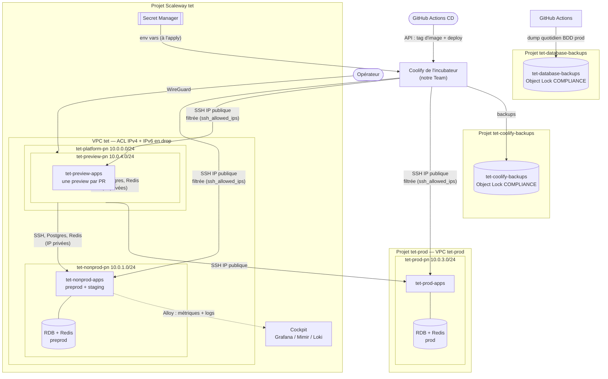
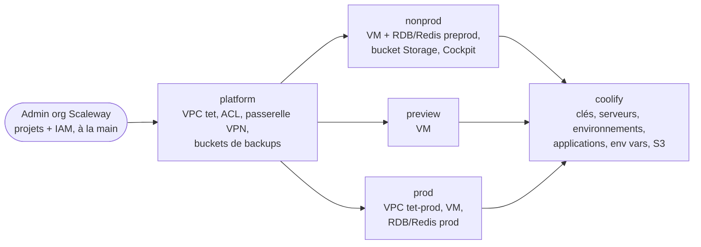

# `infra/` — Infrastructure as Code Scaleway

Terraform qui décrit l'infrastructure TET sur Scaleway : la cible de la migration depuis
Supabase Cloud + Koyeb (cf. [brainstorm de référence](../doc/plans/2026-05-15-001-migration-infra-supabase-koyeb-vers-scaleway-coolify.md)).

**En bref** : l'instance **Coolify de l'incubateur**, où nous avons notre propre Team,
déploie les applications sur trois serveurs applicatifs (prod, nonprod, preview).
Terraform crée les serveurs, réseaux et bases, puis configure notre Team Coolify
(« Coolify-as-code »). Les opérateurs passent par un **VPN WireGuard**. Les secrets fournis
par un humain vivent dans **Secret Manager**. Ceux que Terraform génère ou lit pour les
injecter sont aussi dans le state : accéder au bucket `tet-tfstate` vaut accès à eux (cf.
[Secrets à déposer](#secrets-à-déposer-à-la-main)).

Procédures ponctuelles (restauration de base, bascule de prod) : [`RUNBOOKS.md`](RUNBOOKS.md).

## Vue d'ensemble



Non dessinés : les utilisateurs arrivent en HTTPS sur le Traefik de chaque serveur, et les
serveurs tirent leurs images de `ghcr.io`.

| Serveur            | Projet         | Rôle                                                     |
| ------------------ | -------------- | -------------------------------------------------------- |
| `tet-platform-vpn` | `tet`          | Passerelle WireGuard des opérateurs. Aucune application. |
| `tet-prod-apps`    | **`tet-prod`** | Applications de production.                              |
| `tet-nonprod-apps` | `tet`          | Mutualisé : preprod **et** staging.                      |
| `tet-preview-apps` | `tet`          | Previews éphémères, une par pull request.                |

| Environnement | Postgres / Redis              |
| ------------- | ----------------------------- |
| prod          | managés Scaleway (RDB, Redis) |
| preprod       | managés Scaleway (RDB, Redis) |
| staging       | conteneurs Coolify            |
| preview       | conteneurs Coolify, éphémères |

Preprod est sur du managé pour rester **iso-prod** : l'admin RDB Scaleway n'est pas
superuser, d'où `scaleway_rdb_user.supabase_auth_admin`, le rôle `postgres` NOLOGIN factice
et `pgcrypto` commenté dans
[`nonprod/supabase-api/sql/001-bootstrap-auth-roles.sql`](nonprod/supabase-api/sql/001-bootstrap-auth-roles.sql).
Un Postgres conteneurisé, superuser, masquerait cette classe de bug jusqu'à la production.

Sur chaque serveur applicatif tournent, déployés par Coolify : `app`, `backend`, `site`,
`supabase-api` (GoTrue + Storage, [`nonprod/supabase-api/`](nonprod/supabase-api/)) et
l'agent Alloy. Pour l'instant, seule la preprod est ouverte (`application_environments`).

## Réseau

Deux VPC **sans aucun lien** : `tet` (projet principal, un Private Network par tier hors
prod) et `tet-prod` (un seul Private Network avec serveur, Postgres et Redis de prod).
`10.0.2.0/24` est libre : staging vit sur le serveur nonprod.

- **Coolify** (instance de l'incubateur, hors de nos VPC) joint chaque serveur en SSH sur
  son **IP publique**. Le port 22 n'y est ouvert qu'aux `ssh_allowed_ips` du stack du tier :
  l'IP de sortie de l'instance de l'incubateur et celle de la passerelle VPN. Si l'une
  change, réappliquer les trois stacks de tier.
- **Opérateurs** : par le VPN (cf. [Accès aux serveurs](#accès-aux-serveurs-vpn)). Dans le
  VPC `tet`, les ACL (IPv4 **et** IPv6) n'autorisent que la passerelle VPN vers nonprod et
  preview, en TCP 22, 5432 et 6379.
- La prod n'a **aucune route** depuis ce VPC : le VPN la joint sur son IP publique, comme
  Coolify. Une erreur d'ACL côté nonprod ou preview ne peut donc pas ouvrir la prod.
- Le trafic intra-PN (app → Postgres/Redis) n'est pas filtré : il reste en L2.

> Les Security Groups Scaleway ne filtrent que l'**interface publique** ; les ACL du VPC
> sont le seul contrôle du trafic privé. Chaque Private Network reçoit d'office un /64
> IPv6 non désactivable, et Scaleway tient une ACL par version d'IP : l'ACL IPv6 refuse
> tout. Sans elle, l'IPv6 serait routé librement et la prod redeviendrait joignable.

Le plan d'adressage est dans `platform/variables.tf` (`network_plan`) et
`prod/variables.tf`. Nonprod et preview redéclarent l'IP de leur serveur dans
`server_private_ipv4_address` : **les deux doivent rester alignés**.

## Stacks Terraform



Ordre d'application : `platform → nonprod / prod / preview → coolify`.

- **Un state par stack**, dans le bucket `tet-tfstate`, avec locking natif
  (`use_lockfile`, cf. [Bootstrap](#bootstrap-une-fois)).
- **Pas de `terraform_remote_state`** : chaque flèche est un report manuel d'outputs
  (IDs de Private Network, IP du VPN, IPs des serveurs, noms de secrets) dans le
  `terraform.tfvars` du stack suivant. Les stacks restent découplés.
- `coolify` a son propre state parce qu'il suppose Coolify **déjà joignable** : le `plan`
  de l'infra Scaleway n'exige pas que l'application tourne.

```
infra/
├── modules/             network, vpn, app-server, postgres, redis, cockpit,
│                        cockpit-dashboards
├── platform/            socle transverse
├── nonprod/ prod/ preview/   un stack par tier (nonprod porte aussi supabase-api/ et Cockpit)
├── coolify/             Coolify-as-code
├── observability/       config Alloy + règles d'alerte
└── scripts/             helpers à sourcer (tf-env.sh, coolify-env.sh) et scripts d'API Coolify
```

## Démarrer

### Prérequis

- **Terraform >= 1.10** (pour `use_lockfile`), `scw`, [`aws`](https://www.scaleway.com/en/docs/object-storage/api-cli/object-storage-aws-cli/#how-to-install-the-aws-cli),
  `jq`, `curl`, `ssh`, `psql`, et `wireguard-tools` (`wg`, `wg-quick`) pour le VPN.
- Un compte Scaleway configuré : `brew install scw && scw init`.

### Prérequis admin (organisation Scaleway)

Créer un projet ou une application IAM exige des droits d'organisation, que les
credentials Terraform n'ont pas. Un admin crée donc, une fois :

1. **Quatre projets** : `tet` (principal), `tet-prod`, `tet-coolify-backups` et
   `tet-database-backups`. Leurs IDs vont dans `main_project_id`, `prod_project_id`,
   `coolify_backups_project_id` et `database_backups_project_id` de
   `platform/terraform.tfvars`.
2. **Les droits des opérateurs Terraform** sur ces projets :
   - `tet-prod` : serveur, VPC, IPAM, RDB, Redis, secrets et DNS. Le plus simple :
     `AllProductsFullAccess` limité à ce projet ;
   - `tet-coolify-backups` et `tet-database-backups` : `ObjectStorageFullAccess` limité à
     ces projets. Le verrou COMPLIANCE empêche quand même toute suppression de version avant
     l'échéance.
3. **L'application IAM `tet-coolify-backups`** :
   - une politique limitée à `tet-coolify-backups`, avec `ObjectStorageBucketsRead`,
     `ObjectStorageObjectsRead`, `ObjectStorageObjectsWrite` et
     `ObjectStorageObjectsDelete`. Surtout pas `BucketsWrite` : la clé ne doit toucher ni
     le cycle de vie, ni le verrou, ni la politique du bucket ;
   - une clé d'API dont le **projet par défaut est `tet-coolify-backups`** (l'API S3 résout les
     buckets dans le projet par défaut de la clé), transmise par un canal sûr puis déposée
     dans Secret Manager (cf. [Secrets à déposer](#secrets-à-déposer-à-la-main)).
4. **L'application IAM `tet-database-backups`**, pour les dumps de la BDD de prod faits par
   GitHub Actions : `ObjectStorageBucketsRead`, `ObjectStorageObjectsRead` et
   `ObjectStorageObjectsWrite`, limités au projet `tet-database-backups`, qui est aussi le
   projet par défaut de sa clé. Pas de `ObjectsDelete` : le cycle de vie du bucket fait la
   rétention. Sa clé va dans l'environnement GitHub `prod` (cf.
   [Backups de la BDD de prod](#backups-de-la-bdd-de-prod)).

### Bootstrap (une fois)

Le bucket de state doit exister avant le premier `terraform init`, avec versioning **et**
Object Lock : ce dernier active les conditional writes S3 (`If-None-Match: *`) dont dépend
`use_lockfile`. Un plan ou apply concurrent échoue alors immédiatement.

```sh
scw object bucket create name=tet-tfstate region=fr-par enable-versioning=true

aws s3api put-object-lock-configuration \
  --endpoint-url https://s3.fr-par.scw.cloud \
  --bucket tet-tfstate \
  --object-lock-configuration '{
    "ObjectLockEnabled": "Enabled",
    "Rule": { "DefaultRetention": { "Mode": "GOVERNANCE", "Days": 30 } }
  }'
```

### Appliquer un stack

Avant le premier apply de `platform`, déposer `tet-platform-vpn-private-key` (cf.
[VPN](#mise-en-place-une-fois)) : le stack la lit et échoue sans elle.

```sh
# `source`, pas exécuter : sinon les exports se perdent dans le sous-shell
source infra/scripts/tf-env.sh

cd infra/platform
cp terraform.tfvars.example terraform.tfvars && $EDITOR terraform.tfvars
terraform init
terraform plan -out=tfplan
terraform apply tfplan
```

[`scripts/tf-env.sh`](scripts/tf-env.sh) lit `scw config` et exporte `AWS_*` (backend S3),
`SCW_*` (provider) et `TF_VAR_scaleway_secret_key` (provider Grafana). Il **retire**
`SCW_DEFAULT_PROJECT_ID` : le provider le préférerait au `project_id` de chaque stack.

Pour un stack applicatif, reporter les valeurs de `platform` dans son `terraform.tfvars` :

```sh
terraform -chdir=platform output -json private_network_ids | jq -r .nonprod
terraform -chdir=platform output -raw vpn_public_ip   # + IP de l'instance Coolify → ssh_allowed_ips
```

Une fois les stacks applicatifs appliqués, reporter leur `server_public_ip` dans
`vpn_routed_public_ips` de `platform`, réappliquer `platform`, puis mettre à jour
`AllowedIPs` dans la configuration WireGuard de chaque opérateur
(`vpn_client_allowed_ips`) : sans cela, le tunnel ne relaie pas les IP publiques des
serveurs.

Après le premier apply d'un stack applicatif, récupérer les mots de passe générés
(`terraform output -raw pg_admin_password`, `redis_admin_password`,
`supabase_auth_admin_password`) et les ranger dans Secret Manager.

Pour le stack `coolify`, sourcer en plus `scripts/coolify-env.sh` (`COOLIFY_ENDPOINT`,
`COOLIFY_TOKEN`), après avoir [créé le token](#instance-coolify-de-lincubateur) et
[déposé ses secrets](#secrets-à-déposer-à-la-main), et se connecter au VPN.

### Hygiène

```sh
terraform fmt -recursive
for lock in */.terraform.lock.hcl; do
  d=$(dirname $lock)
  terraform -chdir=$d init -backend=false && terraform -chdir=$d validate
done
tflint --recursive
```

Le `.terraform.lock.hcl` de chaque stack est versionné : il fige les versions des providers.

## Accès aux serveurs (VPN)

Les opérateurs passent par une passerelle **WireGuard** (`tet-platform-vpn`, module
[`modules/vpn`](modules/vpn)). Le tunnel relaie le VPC `tet` (SSH, Postgres et Redis de
nonprod et preview, filtrés par l'ACL) et les IP publiques des serveurs (`vpn_routed_public_ips`),
dont la prod. La passerelle masque ses clients derrière son IP : les serveurs, l'ACL et
les security groups ne voient qu'elle.

La passerelle n'a pas d'état : changer un pair ou une route **remplace la VM** (une à deux
minutes de coupure du tunnel). Son IP publique, sa clé WireGuard (Secret Manager) et sa clé
d'hôte SSH survivent au remplacement : les postes n'ont rien à changer.

Chaque serveur a **sa propre clé SSH root** (`tet-<tier>-server-ssh-key` dans Secret
Manager) : révoquer un serveur compromis ne casse pas les autres.

### Mise en place (une fois)

```sh
# Clé de la passerelle, déposée à la main : elle ne doit pas changer avec la VM
wg genkey | scw secret version create \
  "$(scw secret secret create name=tet-platform-vpn-private-key project-id=<projet-principal> -o json | jq -r .id)" \
  data=@/dev/stdin
```

### Ajouter un opérateur

1. Sur son poste : `(umask 077 && wg genkey | tee tet.key | wg pubkey)`. `tet.key` est sa
   clé privée, lisible par lui seul ; la ligne affichée est la publique.
2. Dans `platform/terraform.tfvars`, ajouter
   `"<prenom.nom>" = { public_key = "<publique>", address = "10.99.0.<n>" }` à `vpn_peers`
   et, s'il doit administrer la passerelle (`ssh tet-ops@10.99.0.1`), sa clé SSH publique à
   `vpn_ssh_authorized_keys`. Appliquer `platform`.
3. Sa configuration (`/etc/wireguard/tet.conf`, ou l'app WireGuard) :

```ini
[Interface]
PrivateKey = <contenu de tet.key>
Address = 10.99.0.<n>/32

[Peer]
# scw secret version access-by-path secret-name=tet-platform-vpn-private-key secret-path=/ \
#   revision=latest -o json | jq -r .data | base64 -d | wg pubkey
PublicKey = <publique de la passerelle>
Endpoint = <terraform -chdir=infra/platform output -raw vpn_endpoint>
AllowedIPs = <terraform -chdir=infra/platform output -raw vpn_client_allowed_ips>
PersistentKeepalive = 25
```

Retirer un opérateur : supprimer son entrée de `vpn_peers` et, s'il administrait la
passerelle, sa clé de `vpn_ssh_authorized_keys` et toute IP de secours qui lui est propre
dans `vpn_ssh_allowed_ips`. Appliquer `platform`.

### Se connecter

Épingler une fois les clés d'hôte, générées par Terraform, plutôt que d'accepter la
première venue. Commandes à lancer depuis la racine du dépôt :

```sh
{
  for t in nonprod preview prod; do
    echo "$(terraform -chdir=infra/$t output -raw server_public_ip) $(terraform -chdir=infra/$t output -raw server_sshd_host_public_key)"
  done
  echo "$(terraform -chdir=infra/platform output -raw vpn_gateway_tunnel_ip) $(terraform -chdir=infra/platform output -raw vpn_sshd_host_public_key)"
} >> ~/.ssh/known_hosts
```

Un « REMOTE HOST IDENTIFICATION HAS CHANGED » n'est jamais anodin : soit le serveur a été
recréé (mettre à jour la ligne), soit la connexion est interceptée.

Sur macOS, l'app WireGuard du Mac App Store remplace `wg-quick` :
importer `tet.conf` (« Import tunnel(s) from file ») donne une icône
dans la barre des menus, qui montre l'état du tunnel et le bascule sans `sudo`.
Ne pas faire tourner les deux à la fois (`sudo wg-quick down tet` avant l'import).

```sh
wg-quick up tet

# Un serveur, en root avec sa clé (prod : ajouter project-id=<projet tet-prod>)
scw secret version access-by-path \
  secret-name="$(terraform -chdir=infra/nonprod output -raw server_ssh_key_secret_name)" \
  secret-path=/ revision=latest -o json | jq -r '.data' | base64 -d > /tmp/srv_key
chmod 600 /tmp/srv_key
ssh -i /tmp/srv_key root@$(terraform -chdir=infra/nonprod output -raw server_public_ip)

# Postgres preprod, en direct sur son IP privée
psql "host=$(terraform -chdir=infra/nonprod output -raw pg_private_endpoint_ip) …"

# La passerelle elle-même
ssh tet-ops@10.99.0.1
```

Tunnel tombé : `vpn_ssh_allowed_ips` ouvre en secours le 22 public de la passerelle à une
IP donnée, sinon console Scaleway.

Contrôle d'isolation, depuis le serveur nonprod : `nc -zv -w3 10.0.3.10 22` et
`nc -zv -w3 <ip-publique-prod> 22` doivent tous deux finir en timeout.

## Coolify

### Instance Coolify de l'incubateur

Nous n'administrons pas l'instance : son admin en gère la version, les réglages, le proxy
de son propre serveur et la sauvegarde. Nous avons une **Team** dédiée, dont nous sommes
admins, et tout ce que décrit le stack `coolify` vit dans cette Team.

1. Dans notre Team, **Security → API Tokens** → créer un token **scope `root`** (limité à
   la Team) et le ranger dans Secret Manager (cf. ci-dessous).
2. `coolify_endpoint` dans `coolify/terraform.tfvars` : `https://<instance>/api/v1`.
3. L'IP de sortie de l'instance, fournie par son admin, va dans `ssh_allowed_ips` des
   stacks `nonprod`, `preview` et `prod`. Elle doit rester fixe.

Les admins de l'instance peuvent lire ce que contient notre Team, clés SSH root et
variables d'environnement comprises. C'est le prix de la mutualisation, à garder en tête
avant d'y confier un secret qui ne sert pas aux applications.

### Secrets à déposer à la main

Ces secrets ne sont jamais créés par Terraform avec leur valeur. Tous dans le projet
principal. `tet-platform-vpn-private-key` passe pourtant en clair par le state de
`platform`, qui la lit pour l'injecter dans le `user_data` de la passerelle.

Le state contient aussi tout ce que Terraform génère : clés SSH root et clés d'hôte des
serveurs et de la passerelle (`tls_private_key`), mots de passe des bases
(`random_password`). Les droits sur `tet-tfstate` sont donc ceux d'un accès root aux
serveurs : à réserver aux opérateurs Terraform.

| Secret                                | Format                       | Contenu                                                                                           |
| ------------------------------------- | ---------------------------- | ------------------------------------------------------------------------------------------------- |
| `tet-platform-coolify-api-token`      | `<id>\|<token>`              | Token API `root` de notre Team Coolify (créé dans l'UI)                                           |
| `tet-platform-vpn-private-key`        | sortie de `wg genkey`        | Clé privée WireGuard de la passerelle (cf. [VPN](#mise-en-place-une-fois))                        |
| `tet-platform-ghcr-pull`              | `<github-username>\|<pat>`   | PAT GitHub **classic**, scope `read:packages` seul, idéalement sur un machine user                |
| `tet-platform-coolify-s3-credentials` | `<access_key>\|<secret_key>` | Clé de l'application IAM `tet-coolify-backups` (créée par l'admin). Coquille créée par `platform` |

```sh
# Créer le secret s'il n'existe pas (api-token, ghcr-pull)…
_id="$(scw secret secret create name=<nom> project-id=<projet-principal> -o json | jq -r .id)"
# …ou le retrouver
_id="$(scw secret secret list name=<nom> project-id=<projet-principal> -o json | jq -r '.[0].id')"
printf '%s|%s' '<partie-1>' '<partie-2>' | scw secret version create "$_id" data=@/dev/stdin
```

- **GHCR** : pas de PAT fine-grained, GHCR ne les accepte pas (`docker login` réussit mais
  tout pull répond `denied`). Si l'org impose le SSO, autoriser le PAT. Vérification :
  `curl -sI -H "Authorization: token <pat>" https://api.github.com/user | grep -i x-oauth-scopes`.
  Coolify n'a pas d'API pour ça :
  [`scripts/coolify-ghcr-docker-login.sh`](scripts/coolify-ghcr-docker-login.sh) écrit
  `/root/.docker/config.json` sur chaque serveur, en SSH : appliquer `coolify` connecté au VPN.
- **Rotation** : déposer une nouvelle version du secret, incrémenter
  `ghcr_pull_credentials_revision` ou `s3_credentials_revision` dans
  `coolify/terraform.tfvars`, appliquer `coolify`. Pour S3, l'admin supprime ensuite
  l'ancienne clé.

### Ce que gère le stack `coolify`

Via le provider [`coolify-terraform/coolify`](https://registry.terraform.io/providers/coolify-terraform/coolify)
et, là où il ne convient pas, des scripts d'API dans `scripts/` :

| Quoi                                       | Comment                                                                           |
| ------------------------------------------ | --------------------------------------------------------------------------------- |
| Clés SSH, serveurs, projet, environnements | ressources natives (`plan` détecte le drift de l'UI)                              |
| Applications `app`, `backend`, `site`      | `coolify_application_docker_image` ([`applications.tf`](coolify/applications.tf)) |
| Services `supabase-api` et Alloy           | `coolify_service` ([`services.tf`](coolify/services.tf))                          |
| Variables d'environnement                  | script `coolify-push-env.sh`                                                      |
| S3 storage (cible des backups Coolify)     | script `coolify-configure-s3-storage.sh`                                          |
| Login GHCR sur les serveurs                | script `coolify-ghcr-docker-login.sh`                                             |

Env vars, S3 et GHCR restent en scripts par choix : le provider stocke tout secret qu'il
gère dans le state (aucun attribut write-only), et son API « bulk » d'env vars ignore
`is_multiline`/`is_literal`. Les scripts lisent Secret Manager à l'apply et n'écrivent rien
dans le state. À revisiter si le provider gagne des attributs `*_wo`.

> ⚠️ `coolify_server` et `coolify_environment` suppriment **en cascade** (applications et
> bases comprises) et portent donc `prevent_destroy`. Retirer un serveur ou un
> environnement se fait en deux temps : `terraform state rm`, puis suppression dans l'UI,
> qui refuse tant qu'il reste des ressources dessus.

Vérifier que Coolify voit ses serveurs :

```sh
curl -sH "Authorization: Bearer $COOLIFY_TOKEN" "$COOLIFY_ENDPOINT/servers" | jq -r '.[] | "\(.name) \(.ip)"'
```

### Déploiement des applications

Terraform déclare les applications (image, domaines, port, healthcheck) mais **ne possède
pas le tag d'image** : il ne le pose qu'à la création, puis l'ignore. C'est la CD
(`.github/workflows/cd-*.yml`, cible `preprod-scaleway`) qui choisit la version :

```sh
APP_ID=preprod/app IMAGE_TAG=<sha> infra/scripts/coolify-deploy.sh
```

Les scripts retrouvent chaque application par le marqueur `(tet-app=<env>/<app>)` de sa
description (`(tet-service=…)` pour un service, `(tet-server=…)` pour un serveur) : la CD
n'a besoin d'aucun UUID. Coolify ≥ 4.7 refuse `[ ] :` dans une description, d'où ce format.
Les environnements s'ouvrent un par un via `application_environments` (défaut
`["preprod"]`). Retirer une application du catalogue ne la supprime pas de Coolify. Feuille de route :
[`doc/plans/2026-10-06-001-infra-applications-coolify-as-code-plan.md`](../doc/plans/2026-10-06-001-infra-applications-coolify-as-code-plan.md).

### Applications Git (aldo, rencontres)

Les produits voisins, chacun dans son dépôt public, sont déclarés dans
[`coolify/git-applications.tf`](coolify/git-applications.tf) : Coolify clone la branche et
construit l'image sur le serveur cible (Railpack). Ils ont leurs propres domaines, donc ne
suivent pas `application_environments`. Variables : même manifeste que les autres
(`env-manifest.tf`).

Mise en service d'une entrée :

1. `terraform apply` : il crée l'application et les coquilles de secrets, puis échoue sur
   `env_push` (« secret sans version »), ce qui est attendu. Déposer les secrets listés par
   `env_manual_secrets` (`SECRET_PROJECT_ID=<projet tet-prod>` pour la prod), puis
   réappliquer : l'`env_push` en échec est rejoué, sans toucher à `coolify_env_revision`.
2. Premier déploiement : bouton **Deploy** dans Coolify, ou
   `APP_ID=<env>/<app> infra/scripts/coolify-deploy.sh` (sans `IMAGE_TAG` : tête de branche).
3. Redéploiement au push : dans le dépôt GitHub, **Settings → Webhooks** →
   `https://<instance>/webhooks/source/github/events/manual`,
   `application/json`, événement _push_, avec le secret de l'onglet **Webhooks** de
   l'application dans Coolify. Retirer ensuite l'auto-deploy du service Koyeb.
4. Domaine hors `*.preprod` : le déclarer d'abord en `http://<nom>`. Avec `https://`,
   Traefik tenterait un certificat Let's Encrypt sur un nom qui pointe encore vers Koyeb, et
   les échecs répétés peuvent bloquer l'émission après la bascule. Vérifier avec
   `curl --resolve <nom>:80:<ip du serveur> http://<nom>/`, passer chez Cloudflare le CNAME
   Koyeb en A vers le serveur (DNS only), puis déclarer `https://<nom>`, appliquer et
   redéployer : Traefik émet le certificat dans la minute. Redéployer aussi le service
   Alloy du serveur (`<env>/alloy`, bouton **Redeploy** dans Coolify) : il ne relit
   `PROBE_TARGETS`, qui gagne la sonde HTTPS de l'application, qu'au démarrage. Mettre le
   service Koyeb en pause une fois le trafic basculé.

### Variables d'environnement (Secret Manager → Coolify)

[`coolify/env-manifest.tf`](coolify/env-manifest.tf) liste, par environnement et par
application, chaque variable : valeur en clair (`value`) ou nom de secret (`secret`), rangé
sous `/coolify-env/<env>/tet-<env>-<nom>`.

| Secret                                             | Coquille créée par                               | Valeur déposée par |
| -------------------------------------------------- | ------------------------------------------------ | ------------------ |
| Dérivés de l'infra (URI Postgres, URI et CA Redis) | stack du tier (`nonprod/coolify-env-secrets.tf`) | Terraform          |
| Applicatifs (clés Supabase, Brevo, Google…)        | `coolify/env-secrets.tf`                         | un opérateur       |

```sh
terraform -chdir=infra/coolify output env_manual_secrets   # ce qui est attendu
infra/scripts/coolify-env-secret-set.sh preprod brevo-api-key < brevo.txt
jq -c . sa.json | infra/scripts/coolify-env-secret-set.sh preprod gcloud-service-account-key
# puis incrémenter coolify_env_revision dans coolify/terraform.tfvars et appliquer
```

[`scripts/coolify-push-env.sh`](scripts/coolify-push-env.sh) résout toutes les valeurs
**avant** d'écrire : un secret manquant fait échouer l'apply sans rien modifier.

- **Le manifeste fait autorité** : `coolify_env_prune = true` (défaut) supprime toute
  variable absente du manifeste, y compris celles ajoutées dans l'UI.
- **Interdits**, bloqués par des préconditions : les clés fournies par l'image
  (`GIT_SHORT_HASH`, `APPLICATION_VERSION`, `NODE_ENV`, `PORT`, `HOSTNAME`…), les
  `NEXT_PUBLIC_*`, et une valeur en clair sur une clé au nom sensible. Toutes les variables
  sont poussées en runtime seulement : un `NEXT_PUBLIC_*` n'atteindrait pas le build.
- **Pousser ne redéploie pas** : redéployer avec `APP_ID=<env>/<app> coolify-deploy.sh`.
  Sans `IMAGE_TAG`, il redéploie la version en place : la même image pour une application
  « image Docker », la tête de branche pour une application Git.
- **Ajouter une clé** : une ligne dans le manifeste. Pour un secret, l'`apply` crée sa
  coquille puis échoue en la signalant vide : déposer la valeur, réappliquer.

### Sauvegarde

La sauvegarde de l'instance revient à son admin. Notre reprise ne dépend pas d'elle : tout
ce que contient notre Team se recrée par `terraform apply` (serveurs, applications,
variables lues dans Secret Manager). Restent à refaire à la main : les webhooks GitHub des
applications Git et les flags de métriques Traefik de chaque serveur.

Les bases des applications sont sauvegardées par Coolify dans `tet-coolify-backups` (S3
storage de notre Team), sous **Object Lock COMPLIANCE** (14 jours).

## Backups de la BDD de prod

Le workflow `.github/workflows/backup-database.yml` dumpe chaque nuit la BDD de prod
(`data_layer/backup/backup.sh`), l'envoie dans le bucket `tet-database-backups` (stack
`platform`) et restaure staging et preprod depuis ce bucket. Object Lock COMPLIANCE
(14 jours), comme `tet-coolify-backups`.

La rétention est faite par le cycle de vie du bucket, par préfixe : tous les dumps sous
`daily/` (14 jours), celui du lundi aussi sous `weekly/` (28 jours), celui du 1er du mois
aussi sous `monthly/` (365 jours). La clé du workflow n'a donc pas le droit de supprimer.

Variables et secrets de l'environnement GitHub `prod` :

| Nom                            | Type     | Valeur                                             |
| ------------------------------ | -------- | -------------------------------------------------- |
| `BACKUP_BUCKET`                | variable | output `database_backups_bucket_name`              |
| `BACKUP_ENDPOINT_URL`          | variable | output `coolify_backups_s3_endpoint`               |
| `BACKUP_REGION`                | variable | `fr-par`                                           |
| `BACKUP_AWS_ACCESS_KEY_ID`     | variable | access key de l'application `tet-database-backups` |
| `BACKUP_AWS_SECRET_ACCESS_KEY` | secret   | secret key de la même application                  |

Le bucket a son propre projet, `tet-database-backups` : les permissions IAM Object Storage
valent pour un projet entier, et les dumps ne sont pas chiffrés. Dans le projet
`tet-coolify-backups`, la clé Coolify pourrait les lire, ou déposer un faux dump que
`restore.sh` restaurerait.

## DNS

Tout reste chez Cloudflare, hors Terraform, en **DNS only** (Traefik émet lui-même ses
certificats en HTTP-01) :

| Nom                                            | Type | Cible                                                         |
| ---------------------------------------------- | ---- | ------------------------------------------------------------- |
| `preprod`, `*.preprod`, `staging`, `*.staging` | A    | `terraform -chdir=infra/nonprod output -raw server_public_ip` |
| `preview`, `*.preview`                         | A    | `terraform -chdir=infra/preview output -raw server_public_ip` |

À reporter à la main si un serveur est recréé. Pas de sous-zones déléguées à Scaleway
Domains : un domaine externe dont l'apex ne pointe pas sur les NS de Scaleway y est supprimé
au bout de 14 jours, zones comprises (incident du 2026-10-23). À reconsidérer après la
migration de la prod.

## Observabilité (Cockpit)

Monitoring et alerting passent par **Cockpit** (Grafana/Mimir/Loki managés par Scaleway),
un par projet Scaleway, défini une fois dans `modules/cockpit` : `nonprod/observability.tf`
l'instancie pour le projet principal (preprod, staging, preview), `prod/observability.tf`
pour tet-prod. Les données de la prod restent dans son projet. PostHog garde l'analytics
produit, l'error tracking et les traces du backend.

| Source                               | Collecte          | Contenu                                             |
| ------------------------------------ | ----------------- | --------------------------------------------------- |
| RDB, Redis, Instances                | Scaleway, gratuit | métriques produits + alertes préconfigurées         |
| Hôte, conteneurs (cAdvisor), Traefik | Alloy             | CPU, mémoire, disques, OOM, requêtes, latence       |
| Sondes HTTPS (blackbox)              | Alloy             | disponibilité, expiration TLS                       |
| Logs des conteneurs Coolify          | Alloy             | stdout/stderr, labels `env`, `service`, `container` |

- **Cockpit** : sources custom (métriques 31 j, logs 14 j), token d'écriture d'Alloy, alert
  manager et destinataires (`alert_emails`). Token et URL de push vont dans Secret Manager,
  d'où `coolify` les pousse.
- **Alloy** ([`observability/alloy/`](observability/alloy/)) : un service Coolify par
  serveur, qui pousse vers le Cockpit du projet de son serveur (labels `server`, `env`).
  Sondes HTTPS : dérivées des applications et services déclarés (`alloy_probes`,
  `coolify/services.tf`). Nouveau serveur : `alloy_environments`, même fichier.
  `config.alloy` est déposé en file storage : après modification et apply,
  **redémarrer le service**.
- **Règles d'alerte** ([`observability/rules/`](observability/rules/)) : hors Terraform,
  poussées dans chaque Cockpit par `make -C infra/nonprod cockpit-rules` et
  `make -C infra/prod cockpit-rules` (`scripts/cockpit-rules.sh`).
- **Dashboards** (dossier **TeT** dans Grafana) : définis dans `modules/cockpit-dashboards`.
  Les modifier là, pas dans Grafana, où un apply écraserait la modification. Le provider
  `grafana` demande un rôle Editor (permissions Cockpit complètes de l'IAM).

Accès : console Scaleway > Cockpit > Open dashboards. Logs dans **Explore**, source
`tet-custom-logs`, par exemple `{env="preprod", service="backend"}` ou, dans le Cockpit de
tet-prod, `{env="production", service="aldo"}`.

### Alloy sur un nouveau serveur : ordre

1. **Stack du tier** (`nonprod` ou `prod`) : crée le Cockpit et range token et URL de push
   dans Secret Manager. Tant que ce n'est pas fait, le plan de `coolify` échoue sur la
   lecture de `tet-<env>-cockpit-*` (garde de `coolify/env-secrets.tf`).
2. `make cockpit-rules` dans ce stack.
3. **Métriques Traefik** sur le serveur (ci-dessous) : sans elles, `ScrapeTargetDown` part
   aux `alert_emails` cinq minutes après le démarrage d'Alloy.
4. **Stack `coolify`** : crée le service, pousse ses variables. Puis déployer le service
   dans Coolify.

### Métriques Traefik (une fois par serveur)

Le proxy Coolify n'expose pas ses métriques par défaut. `coolify_server_proxy.configuration`
remplacerait tout le compose du proxy, qu'on devrait alors maintenir nous-mêmes : l'étape
reste manuelle. Dans Coolify > Servers > _serveur_ > Proxy, ajouter à `command` puis
redémarrer le proxy (coupure de quelques secondes) :

```yaml
- '--entrypoints.metrics.address=:8082'
- '--metrics.prometheus=true'
- '--metrics.prometheus.entrypoint=metrics'
- '--metrics.prometheus.addEntryPointsLabels=false'
- '--metrics.prometheus.buckets=0.1,0.3,0.5,1,2,5'
```

Le port 8082 n'est pas publié : Alloy le lit par le réseau Docker `coolify` (sans
entrypoint dédié, Traefik servirait les métriques sur `:8080`, publié). Tant que ce n'est
pas fait, `ScrapeTargetDown` alerte sur `job="traefik"`.

On garde [Sentinel](https://coolify.io/docs/core/observability/monitoring/overview), le
monitoring de Coolify, dont il se sert pour l'état des conteneurs. Son option **Metrics**
est facultative (Alloy couvre). Activer **Analytics**, ou une mise à jour du proxy par
Coolify, reconfigure le proxy : revérifier ensuite les flags ci-dessus.

## CI/CD

- **Applications** : les workflows `cd-app`, `cd-backend` et `cd-site` déploient sur la
  preprod Scaleway (cible `preprod-scaleway`) via `coolify-deploy.sh`.
- **Infra (à venir)** : `fmt` + `validate` + `plan` en commentaire de PR sur `infra/**`,
  `apply` sur `main` avec approbation manuelle (GitHub Environments), authentification
  Scaleway par OIDC plutôt que par clés long-lived.

## Décisions actées

- **Instance Coolify de l'incubateur**, dans une Team dédiée : pas de control plane à
  exploiter. Contrepartie : version et sauvegarde de l'instance hors de nos mains, et ses
  admins voient nos secrets.
- **Production dans un projet séparé**, VPC propre, aucun lien réseau : prod injoignable
  depuis nonprod et preview par construction, pas par filtrage. Pas de VPC Peering : il
  réintroduirait un chemin à filtrer par quatre ACL (IPv4/IPv6 des deux côtés).
- **SSH** : IP publique filtrée sur l'instance Coolify et la passerelle VPN. Les opérateurs
  passent par **WireGuard** auto-hébergé plutôt que par un bastion SSH (accès direct aux
  bases privées) ou Tailscale (plan de contrôle chez un tiers).
- **Backups dans un projet dédié**, bucket sous Object Lock COMPLIANCE : la clé des backups
  ne voit que ce projet.
- **Preprod iso-prod sur du managé**, staging et preview conteneurisés.
- **Mono-VM Coolify par tier** plutôt que Kapsule : pas d'orchestrateur K8s.
- **Un state par stack**, liés par valeurs et noms de secrets, jamais par
  `terraform_remote_state`.
- **GoTrue self-hosté** plutôt que tout Supabase : préserve `JWT_SECRET`, schéma `auth`,
  bcrypt.
- **Sous-domaines dédiés par service** plutôt que reverse proxy unique.
- **Bascule DB** par `pg_dump` / `pg_restore` en fenêtre de maintenance, **pas** de
  réplication logique.
