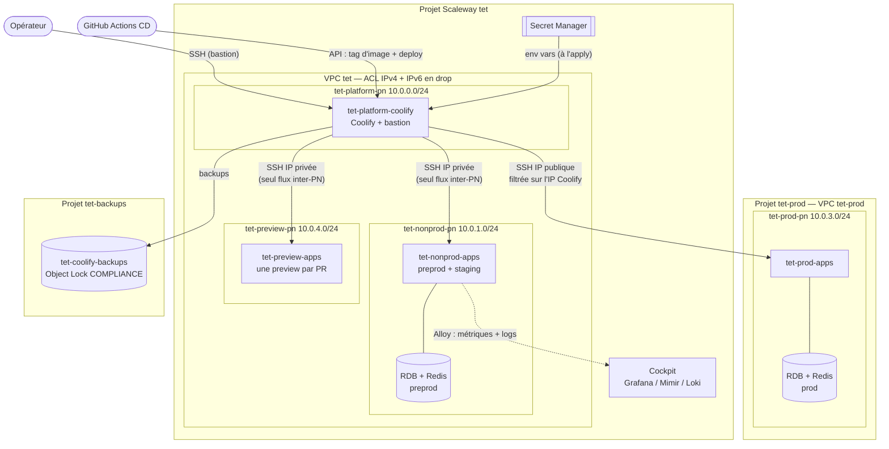
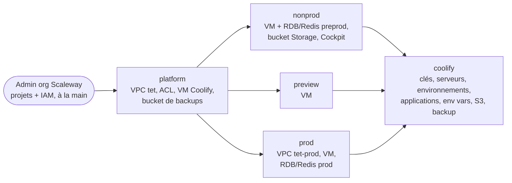

# `infra/` — Infrastructure as Code Scaleway

Terraform qui décrit l'infrastructure TET sur Scaleway : la cible de la migration depuis
Supabase Cloud + Koyeb (cf. [brainstorm de référence](../doc/plans/2026-05-15-001-migration-infra-supabase-koyeb-vers-scaleway-coolify.md)).

**En bref** : une instance **Coolify** unique, sur son propre serveur, déploie les
applications sur trois serveurs applicatifs (prod, nonprod, preview). Terraform crée les
serveurs, réseaux et bases, puis configure Coolify lui-même (« Coolify-as-code »). Les
secrets vivent dans **Secret Manager**, jamais dans le state.

Procédures ponctuelles (restauration de base, bascule de prod, restauration de Coolify,
montée de version) : [`RUNBOOKS.md`](RUNBOOKS.md).

## Vue d'ensemble



Non dessinés : les utilisateurs arrivent en HTTPS sur le Traefik de chaque serveur, et les
serveurs tirent leurs images de `ghcr.io`.

| Serveur                | Projet         | Rôle                                                     |
| ---------------------- | -------------- | -------------------------------------------------------- |
| `tet-platform-coolify` | `tet`          | Control plane Coolify + bastion SSH. Aucune application. |
| `tet-prod-apps`        | **`tet-prod`** | Applications de production.                              |
| `tet-nonprod-apps`     | `tet`          | Mutualisé : preprod **et** staging.                      |
| `tet-preview-apps`     | `tet`          | Previews éphémères, une par pull request.                |

| Environnement | Postgres / Redis              |
| ------------- | ----------------------------- |
| prod          | managés Scaleway (RDB, Redis) |
| preprod       | managés Scaleway (RDB, Redis) |
| staging       | conteneurs Coolify            |
| preview       | conteneurs Coolify, éphémères |

Preprod est sur du managé pour rester **iso-prod** : l'admin RDB Scaleway n'est pas
superuser, d'où `scaleway_rdb_user.supabase_auth_admin`, le rôle `postgres` NOLOGIN factice
et `pgcrypto` commenté dans
[`nonprod/supabase-api/sql/001-bootstrap-auth-roles.sql`](nonprod/supabase-api/sql/001-bootstrap-auth-roles.sql).
Un Postgres conteneurisé, superuser, masquerait cette classe de bug jusqu'à la production.

Sur chaque serveur applicatif tournent, déployés par Coolify : `app`, `backend`, `site`,
`supabase-api` (GoTrue + Storage, [`nonprod/supabase-api/`](nonprod/supabase-api/)) et
l'agent Alloy. Pour l'instant, seule la preprod est ouverte (`application_environments`).

## Réseau

Deux VPC **sans aucun lien** : `tet` (projet principal, un Private Network par tier hors
prod) et `tet-prod` (un seul Private Network avec serveur, Postgres et Redis de prod).
`10.0.2.0/24` est libre : staging vit sur le serveur nonprod.

- Dans le VPC `tet`, les ACL (IPv4 **et** IPv6) n'autorisent qu'un flux inter-PN :
  **TCP/22 du control plane vers nonprod et preview**.
- La prod n'a **aucune route** depuis ce VPC : Coolify la pilote en SSH sur son IP publique,
  que son security group n'ouvre qu'à l'IP publique du control plane (`coolify_public_ip`
  dans `prod/terraform.tfvars`). Une erreur d'ACL côté nonprod ou preview ne peut donc pas
  ouvrir la prod. Contrepartie : si l'IP de Coolify change, réappliquer `prod`.
- Le port 22 est fermé publiquement sur nonprod et preview. Les humains passent par le
  bastion (cf. [Accès aux serveurs](#accès-aux-serveurs-bastion)).
- Le trafic intra-PN (app → Postgres/Redis) n'est pas filtré : il reste en L2.

> Les Security Groups Scaleway ne filtrent que l'**interface publique** ; les ACL du VPC
> sont le seul contrôle du trafic privé. Chaque Private Network reçoit d'office un /64
> IPv6 non désactivable, et Scaleway tient une ACL par version d'IP : l'ACL IPv6 refuse
> tout. Sans elle, l'IPv6 serait routé librement et la prod redeviendrait joignable.

Le plan d'adressage est dans `platform/variables.tf` (`network_plan`) et
`prod/variables.tf`. Nonprod et preview redéclarent l'IP de leur serveur dans
`server_private_ipv4_address` : **les deux doivent rester alignés**, sinon l'ACL bloque le
SSH de Coolify.

## Stacks Terraform



Ordre d'application : `platform → nonprod / prod / preview → coolify`.

- **Un state par stack**, dans le bucket `tet-tfstate`, avec locking natif
  (`use_lockfile`, cf. [Bootstrap](#bootstrap-une-fois)).
- **Pas de `terraform_remote_state`** : chaque flèche est un report manuel d'outputs
  (IDs de Private Network, IP de Coolify, IPs des serveurs, noms de secrets) dans le
  `terraform.tfvars` du stack suivant. Les stacks restent découplés.
- `coolify` a son propre state parce qu'il suppose Coolify **déjà joignable** : le `plan`
  de l'infra Scaleway n'exige pas que l'application tourne.

```
infra/
├── modules/             network, coolify (VM control plane), app-server, postgres,
│                        redis, cockpit-dashboards
├── platform/            socle transverse
├── nonprod/ prod/ preview/   un stack par tier (nonprod porte aussi supabase-api/ et Cockpit)
├── coolify/             Coolify-as-code
├── observability/       config Alloy + règles d'alerte
└── scripts/             helpers à sourcer (tf-env.sh, coolify-env.sh) et scripts d'API Coolify
```

## Démarrer

### Prérequis

- **Terraform >= 1.10** (pour `use_lockfile`), `scw`, [`aws`](https://www.scaleway.com/en/docs/object-storage/api-cli/object-storage-aws-cli/#how-to-install-the-aws-cli),
  `jq`, `curl`, `ssh`, `psql`, et `age` pour les backups.
- Un compte Scaleway configuré : `brew install scw && scw init`.

### Prérequis admin (organisation Scaleway)

Créer un projet ou une application IAM exige des droits d'organisation, que les
credentials Terraform n'ont pas. Un admin crée donc, une fois :

1. **Trois projets** : `tet` (principal), `tet-prod` et `tet-backups`. Leurs IDs vont dans
   `main_project_id`, `prod_project_id` et `backups_project_id` de
   `platform/terraform.tfvars`.
2. **Les droits des opérateurs Terraform** sur ces projets :
   - `tet-prod` : serveur, VPC, IPAM, RDB, Redis, secrets et DNS. Le plus simple :
     `AllProductsFullAccess` limité à ce projet ;
   - `tet-backups` : `ObjectStorageFullAccess` limité à ce projet. Le verrou COMPLIANCE
     empêche quand même toute suppression de version avant l'échéance.
3. **L'application IAM `tet-coolify-backups`** :
   - une politique limitée à `tet-backups`, avec `ObjectStorageBucketsRead`,
     `ObjectStorageObjectsRead`, `ObjectStorageObjectsWrite` et
     `ObjectStorageObjectsDelete`. Surtout pas `BucketsWrite` : la clé ne doit toucher ni
     le cycle de vie, ni le verrou, ni la politique du bucket ;
   - une clé d'API dont le **projet par défaut est `tet-backups`** (l'API S3 résout les
     buckets dans le projet par défaut de la clé), transmise par un canal sûr puis déposée
     dans Secret Manager (cf. [Secrets à déposer](#secrets-à-déposer-à-la-main)).

### Bootstrap (une fois)

Le bucket de state doit exister avant le premier `terraform init`, avec versioning **et**
Object Lock : ce dernier active les conditional writes S3 (`If-None-Match: *`) dont dépend
`use_lockfile`. Un plan ou apply concurrent échoue alors immédiatement.

```sh
scw object bucket create name=tet-tfstate region=fr-par enable-versioning=true

aws s3api put-object-lock-configuration \
  --endpoint-url https://s3.fr-par.scw.cloud \
  --bucket tet-tfstate \
  --object-lock-configuration '{
    "ObjectLockEnabled": "Enabled",
    "Rule": { "DefaultRetention": { "Mode": "GOVERNANCE", "Days": 30 } }
  }'
```

### Appliquer un stack

```sh
# `source`, pas exécuter : sinon les exports se perdent dans le sous-shell
source infra/scripts/tf-env.sh

cd infra/platform
cp terraform.tfvars.example terraform.tfvars && $EDITOR terraform.tfvars
terraform init
terraform plan -out=tfplan
terraform apply tfplan
```

[`scripts/tf-env.sh`](scripts/tf-env.sh) lit `scw config` et exporte `AWS_*` (backend S3),
`SCW_*` (provider) et `TF_VAR_scaleway_secret_key` (provider Grafana). Il **retire**
`SCW_DEFAULT_PROJECT_ID` : le provider le préférerait au `project_id` de chaque stack.

Pour un stack applicatif, reporter les valeurs de `platform` dans son `terraform.tfvars` :

```sh
terraform -chdir=platform output -json private_network_ids | jq -r .nonprod
terraform -chdir=platform output -raw coolify_public_ip
```

Après le premier apply d'un stack applicatif, récupérer les mots de passe générés
(`terraform output -raw pg_admin_password`, `redis_admin_password`,
`supabase_auth_admin_password`) et les ranger dans Secret Manager.

Pour le stack `coolify`, sourcer en plus `scripts/coolify-env.sh` (`COOLIFY_ENDPOINT`,
`COOLIFY_TOKEN`), après avoir [démarré Coolify](#premier-démarrage-de-coolify) et
[déposé ses secrets](#secrets-à-déposer-à-la-main).

### Hygiène

```sh
terraform fmt -recursive
for d in platform nonprod prod preview coolify; do
  terraform -chdir=$d init -backend=false && terraform -chdir=$d validate
done
tflint --recursive
```

Le `.terraform.lock.hcl` de chaque stack est versionné : il fige les versions des providers.

## Accès aux serveurs (bastion)

Le control plane est le seul chemin vers les serveurs applicatifs. Chaque serveur a **sa
propre clé SSH** (`tet-<tier>-server-ssh-key` dans Secret Manager) : révoquer un serveur
compromis ne casse pas les autres.

Les clés d'hôte SSH sont générées par Terraform et installées par cloud-init : les scripts
de `infra/coolify` les vérifient en mode strict. Les épingler une fois dans `known_hosts`
plutôt que d'accepter la première clé présentée :

```sh
{
  echo "$(terraform -chdir=infra/platform output -raw coolify_public_ip) $(terraform -chdir=infra/platform output -raw coolify_sshd_host_public_key)"
  for t in nonprod preview; do
    echo "$(terraform -chdir=infra/$t output -raw server_private_ip) $(terraform -chdir=infra/$t output -raw server_sshd_host_public_key)"
  done
  echo "$(terraform -chdir=infra/prod output -raw server_ssh_host) $(terraform -chdir=infra/prod output -raw server_sshd_host_public_key)"
} >> ~/.ssh/known_hosts
```

Un « REMOTE HOST IDENTIFICATION HAS CHANGED » n'est jamais anodin : soit le serveur a été
recréé (mettre à jour la ligne), soit la connexion est interceptée.

```sh
# Bastion
ssh tet-ops@$(terraform -chdir=infra/platform output -raw coolify_public_ip)

# Rebond vers nonprod (même chose pour preview), en root, avec sa clé
scw secret version access-by-path \
  secret-name="$(terraform -chdir=infra/nonprod output -raw server_ssh_key_secret_name)" \
  secret-path=/ revision=latest -o json | jq -r '.data' | base64 -d > /tmp/srv_key
chmod 600 /tmp/srv_key
ssh -J tet-ops@<ip-coolify> -i /tmp/srv_key \
  root@$(terraform -chdir=infra/nonprod output -raw server_private_ip)

# Prod : clé lue dans le projet tet-prod, rebond vers l'IP publique
scw secret version access-by-path project-id="$(terraform -chdir=infra/platform output -raw prod_project_id)" \
  secret-name="$(terraform -chdir=infra/prod output -raw server_ssh_key_secret_name)" \
  secret-path=/ revision=latest -o json | jq -r '.data' | base64 -d > /tmp/prod_key
chmod 600 /tmp/prod_key
ssh -J tet-ops@<ip-coolify> -i /tmp/prod_key \
  root@$(terraform -chdir=infra/prod output -raw server_ssh_host)
```

Contrôle d'isolation, depuis le serveur nonprod : `nc -zv -w3 10.0.3.10 22` et
`nc -zv -w3 <ip-publique-prod> 22` doivent tous deux finir en timeout.

## Coolify

### Premier démarrage de Coolify

Le port 8000 n'est **jamais** ouvert : le dashboard est servi en HTTPS par le Traefik de
Coolify, une fois son FQDN configuré.

1. Poser chez Cloudflare un A `coolify.territoiresentransitions.fr` vers
   `terraform -chdir=infra/platform output -raw coolify_public_ip` (DNS only).
2. Premier accès par tunnel :
   `ssh -L 8000:localhost:8000 -L 6001:localhost:6001 -L 6002:localhost:6002 tet-ops@<ip-coolify>`
   puis http://localhost:8000 (6001/6002 : temps réel et terminal).
3. Créer le compte admin, puis **Servers → localhost** (**Validate & configure** si besoin)
   → **Proxy** → **Traefik** → **Start Proxy**. Sans ce proxy, rien n'écoute sur 80/443.
4. **Settings → Instance Domain** → le FQDN. Coolify émet son certificat Let's Encrypt
   (HTTP-01 sur le port 80).
5. **Security → API Tokens** → créer un token **scope `root`** et le ranger dans Secret
   Manager (cf. ci-dessous).

Coolify pilote son propre serveur (`localhost`) en SSH. La clé qu'il génère lui-même est
régénérée à chaque update ou réinstall (« Permission denied (publickey) ») : Terraform pose
donc une clé à nous (`tet-platform-coolify-host-ssh-key`), que le stack `coolify` assigne au
serveur `localhost` ([`scripts/coolify-upsert-server.sh`](scripts/coolify-upsert-server.sh)).
L'auto-update est désactivé pour la même raison, et la version est figée
(`coolify_version`) : montée de version dans les [runbooks](RUNBOOKS.md#montée-de-version-de-coolify).

### Secrets à déposer à la main

Ces secrets ne sont jamais créés par Terraform avec leur valeur : ils n'entrent pas dans le
state. Tous dans le projet principal.

| Secret                                | Format                    | Contenu                                                                                     |
| ------------------------------------- | ------------------------- | ------------------------------------------------------------------------------------------- |
| `tet-platform-coolify-api-token`      | `<id>\|<token>`           | Token API Coolify `root` (créé dans l'UI)                                                   |
| `tet-platform-ghcr-pull`              | `<github-username>\|<pat>` | PAT GitHub **classic**, scope `read:packages` seul, idéalement sur un machine user           |
| `tet-platform-coolify-s3-credentials` | `<access_key>\|<secret_key>` | Clé de l'application IAM `tet-coolify-backups` (créée par l'admin). Coquille créée par `platform` |

```sh
# Créer le secret s'il n'existe pas (api-token, ghcr-pull)…
_id="$(scw secret secret create name=<nom> project-id=<projet-principal> -o json | jq -r .id)"
# …ou le retrouver
_id="$(scw secret secret list name=<nom> project-id=<projet-principal> -o json | jq -r '.[0].id')"
printf '%s|%s' '<partie-1>' '<partie-2>' | scw secret version create "$_id" data=@/dev/stdin
```

- **GHCR** : pas de PAT fine-grained, GHCR ne les accepte pas (`docker login` réussit mais
  tout pull répond `denied`). Si l'org impose le SSO, autoriser le PAT. Vérification :
  `curl -sI -H "Authorization: token <pat>" https://api.github.com/user | grep -i x-oauth-scopes`.
  Coolify n'a pas d'API pour ça :
  [`scripts/coolify-ghcr-docker-login.sh`](scripts/coolify-ghcr-docker-login.sh) écrit
  `/root/.docker/config.json` sur chaque serveur, via le bastion.
- **Rotation** : déposer une nouvelle version du secret, incrémenter
  `ghcr_pull_credentials_revision` ou `s3_credentials_revision` dans
  `coolify/terraform.tfvars`, appliquer `coolify`. Pour S3, l'admin supprime ensuite
  l'ancienne clé.

### Ce que gère le stack `coolify`

Via le provider [`coolify-terraform/coolify`](https://registry.terraform.io/providers/coolify-terraform/coolify)
et, là où il ne convient pas, des scripts d'API dans `scripts/` :

| Quoi                                                | Comment                                                     |
| --------------------------------------------------- | ----------------------------------------------------------- |
| Clés SSH, serveurs, projet, environnements          | ressources natives (`plan` détecte le drift de l'UI)        |
| Applications `app`, `backend`, `site`               | `coolify_application_docker_image` ([`applications.tf`](coolify/applications.tf)) |
| Services `supabase-api` et Alloy                    | `coolify_service` ([`services.tf`](coolify/services.tf))    |
| Variables d'environnement                           | script `coolify-push-env.sh`                                |
| S3 storage (cible des backups Coolify)              | script `coolify-configure-s3-storage.sh`                    |
| Login GHCR sur les serveurs                         | script `coolify-ghcr-docker-login.sh`                       |
| Backup de l'instance Coolify                        | script `coolify-install-instance-backup.sh` (timer systemd) |

Env vars, S3 et GHCR restent en scripts par choix : le provider stocke tout secret qu'il
gère dans le state (aucun attribut write-only), et son API « bulk » d'env vars ignore
`is_multiline`/`is_literal`. Les scripts lisent Secret Manager à l'apply et n'écrivent rien
dans le state. À revisiter si le provider gagne des attributs `*_wo`.

> ⚠️ `coolify_server` et `coolify_environment` suppriment **en cascade** (applications et
> bases comprises) et portent donc `prevent_destroy`. Retirer un serveur ou un
> environnement se fait en deux temps : `terraform state rm`, puis suppression dans l'UI,
> qui refuse tant qu'il reste des ressources dessus.

Vérifier que Coolify voit ses serveurs :

```sh
curl -sH "Authorization: Bearer $COOLIFY_TOKEN" "$COOLIFY_ENDPOINT/servers" | jq -r '.[] | "\(.name) \(.ip)"'
```

### Déploiement des applications

Terraform déclare les applications (image, domaines, port, healthcheck) mais **ne possède
pas le tag d'image** : il ne le pose qu'à la création, puis l'ignore. C'est la CD
(`.github/workflows/cd-*.yml`, cible `preprod-scaleway`) qui choisit la version :

```sh
APP_ID=preprod/app IMAGE_TAG=<sha> infra/scripts/coolify-deploy.sh
```

Les scripts retrouvent chaque application par le marqueur `(tet-app=<env>/<app>)` de sa
description (`(tet-service=…)` pour un service, `(tet-server=…)` pour un serveur) : la CD
n'a besoin d'aucun UUID. Coolify ≥ 4.7 refuse `[ ] :` dans une description, d'où ce format.
Les environnements s'ouvrent un par un via `application_environments` (défaut
`["preprod"]`). Retirer une application du catalogue ne la supprime pas de Coolify. Feuille de route :
[`doc/plans/2026-10-06-001-infra-applications-coolify-as-code-plan.md`](../doc/plans/2026-10-06-001-infra-applications-coolify-as-code-plan.md).

### Applications Git (aldo, rencontres)

Les produits voisins, chacun dans son dépôt public, sont déclarés dans
[`coolify/git-applications.tf`](coolify/git-applications.tf) : Coolify clone la branche et
construit l'image sur le serveur cible (Railpack). Ils ont leurs propres domaines, donc ne
suivent pas `application_environments`. Variables : même manifeste que les autres
(`env-manifest.tf`).

Mise en service d'une entrée :

1. `terraform apply` : il crée l'application et les coquilles de secrets, puis échoue sur
   `env_push` (« secret sans version »), ce qui est attendu. Déposer les secrets listés par
   `env_manual_secrets` (`SECRET_PROJECT_ID=<projet tet-prod>` pour la prod), puis
   réappliquer : l'`env_push` en échec est rejoué, sans toucher à `coolify_env_revision`.
2. Premier déploiement : bouton **Deploy** dans Coolify, ou
   `APP_ID=<env>/<app> infra/scripts/coolify-deploy.sh` (sans `IMAGE_TAG` : tête de branche).
3. Redéploiement au push : dans le dépôt GitHub, **Settings → Webhooks** →
   `https://coolify.territoiresentransitions.fr/webhooks/source/github/events/manual`,
   `application/json`, événement *push*, avec le secret de l'onglet **Webhooks** de
   l'application dans Coolify. Retirer ensuite l'auto-deploy du service Koyeb.
4. Domaine hors `*.preprod` : le déclarer d'abord en `http://<nom>`. Avec `https://`,
   Traefik tenterait un certificat Let's Encrypt sur un nom qui pointe encore vers Koyeb, et
   les échecs répétés peuvent bloquer l'émission après la bascule. Vérifier avec
   `curl --resolve <nom>:80:<ip du serveur> http://<nom>/`, passer chez Cloudflare le CNAME
   Koyeb en A vers le serveur (DNS only), puis déclarer `https://<nom>`, appliquer et
   redéployer : Traefik émet le certificat dans la minute. Mettre le service Koyeb en pause
   une fois le trafic basculé.

### Variables d'environnement (Secret Manager → Coolify)

[`coolify/env-manifest.tf`](coolify/env-manifest.tf) liste, par environnement et par
application, chaque variable : valeur en clair (`value`) ou nom de secret (`secret`), rangé
sous `/coolify-env/<env>/tet-<env>-<nom>`.

| Secret                                             | Coquille créée par                           | Valeur déposée par |
| -------------------------------------------------- | -------------------------------------------- | ------------------ |
| Dérivés de l'infra (URI Postgres, URI et CA Redis) | stack du tier (`nonprod/coolify-env-secrets.tf`) | Terraform      |
| Applicatifs (clés Supabase, Brevo, Google…)        | `coolify/env-secrets.tf`                     | un opérateur       |

```sh
terraform -chdir=infra/coolify output env_manual_secrets   # ce qui est attendu
infra/scripts/coolify-env-secret-set.sh preprod brevo-api-key < brevo.txt
jq -c . sa.json | infra/scripts/coolify-env-secret-set.sh preprod gcloud-service-account-key
# puis incrémenter coolify_env_revision dans coolify/terraform.tfvars et appliquer
```

[`scripts/coolify-push-env.sh`](scripts/coolify-push-env.sh) résout toutes les valeurs
**avant** d'écrire : un secret manquant fait échouer l'apply sans rien modifier.

- **Le manifeste fait autorité** : `coolify_env_prune = true` (défaut) supprime toute
  variable absente du manifeste, y compris celles ajoutées dans l'UI.
- **Interdits**, bloqués par des préconditions : les clés fournies par l'image
  (`GIT_SHORT_HASH`, `APPLICATION_VERSION`, `NODE_ENV`, `PORT`, `HOSTNAME`…), les
  `NEXT_PUBLIC_*`, et une valeur en clair sur une clé au nom sensible. Toutes les variables
  sont poussées en runtime seulement : un `NEXT_PUBLIC_*` n'atteindrait pas le build.
- **Pousser ne redéploie pas** : redéployer avec `APP_ID=<env>/<app> coolify-deploy.sh`.
  Sans `IMAGE_TAG`, il redéploie la version en place : la même image pour une application
  « image Docker », la tête de branche pour une application Git.
- **Ajouter une clé** : une ligne dans le manifeste. Pour un secret, l'`apply` crée sa
  coquille puis échoue en la signalant vide : déposer la valeur, réappliquer.

### Sauvegarde de l'instance Coolify

Les backups configurés dans Coolify couvrent les bases des applications, pas Coolify
lui-même, dont la base porte pourtant toute la configuration (applications, variables,
secrets). L'`apply` de `coolify` installe donc sur le control plane un timer quotidien
(`tet-coolify-backup.timer`) qui `pg_dump` `coolify-db`, y joint `/data/coolify/source/.env`
(l'`APP_KEY`, sans laquelle la base est illisible), chiffre le tout avec
[age](https://age-encryption.org) vers les clés des opérateurs et l'envoie sous
`coolify-instance/` dans le bucket de backups (rétention 30 jours, cycle de vie dans
`platform`).

Le bucket `tet-coolify-backups` est sous **Object Lock COMPLIANCE** (14 jours) : personne ne
peut supprimer une version avant l'échéance. Le serveur ne détient aucune clé privée age.

Ajouter un opérateur :

```sh
age-keygen -o ~/tet-coolify-backup.key   # affiche la clé publique (age1…)
```

Ranger la clé privée dans le gestionnaire de mots de passe de l'équipe, **hors** Scaleway,
puis ajouter la clé publique à `instance_backup_age_recipients` dans
`coolify/terraform.tfvars` et appliquer. Les anciens backups restent lisibles par les seules
clés de l'époque. Le premier `apply` lance un backup immédiat et échoue si la chaîne est
cassée. Suivi : `sudo systemctl list-timers tet-coolify-backup.timer` et
`sudo journalctl -u tet-coolify-backup.service -n 20` sur le control plane.

Restauration : [runbook](RUNBOOKS.md#restauration-de-linstance-coolify).

## DNS

Tout reste chez Cloudflare, hors Terraform, en **DNS only** (Traefik émet lui-même ses
certificats en HTTP-01) :

| Nom                                            | Type | Cible                                                    |
| ---------------------------------------------- | ---- | -------------------------------------------------------- |
| `coolify`                                      | A    | `terraform -chdir=infra/platform output -raw coolify_public_ip` |
| `preprod`, `*.preprod`, `staging`, `*.staging` | A    | `terraform -chdir=infra/nonprod output -raw server_public_ip`   |
| `preview`, `*.preview`                         | A    | `terraform -chdir=infra/preview output -raw server_public_ip`   |

À reporter à la main si un serveur est recréé. Pas de sous-zones déléguées à Scaleway
Domains : un domaine externe dont l'apex ne pointe pas sur les NS de Scaleway y est supprimé
au bout de 14 jours, zones comprises (incident du 2026-10-23). À reconsidérer après la
migration de la prod.

## Observabilité (Cockpit)

Monitoring et alerting passent par **Cockpit** (Grafana/Mimir/Loki managés par Scaleway),
un par projet Scaleway, défini une fois dans `modules/cockpit` : `nonprod/observability.tf`
l'instancie pour le projet principal (preprod, staging, preview), `prod/observability.tf`
pour tet-prod. Les données de la prod restent dans son projet. PostHog garde l'analytics
produit, l'error tracking et les traces du backend.

| Source                                    | Collecte          | Contenu                                             |
| ----------------------------------------- | ----------------- | --------------------------------------------------- |
| RDB, Redis, Instances                     | Scaleway, gratuit | métriques produits + alertes préconfigurées         |
| Hôte, conteneurs (cAdvisor), Traefik      | Alloy             | CPU, mémoire, disques, OOM, requêtes, latence       |
| Sondes HTTPS (blackbox)                   | Alloy             | disponibilité, expiration TLS                       |
| Logs des conteneurs Coolify               | Alloy             | stdout/stderr, labels `env`, `service`, `container` |

- **Cockpit** : sources custom (métriques 31 j, logs 14 j), token d'écriture d'Alloy, alert
  manager et destinataires (`alert_emails`). Token et URL de push vont dans Secret Manager,
  d'où `coolify` les pousse.
- **Alloy** ([`observability/alloy/`](observability/alloy/)) : un service Coolify par
  serveur, qui pousse vers le Cockpit du projet de son serveur (labels `server`, `env`).
  Sondes HTTPS : dérivées des applications et services déclarés (`alloy_probes`,
  `coolify/services.tf`). Nouveau serveur : `alloy_environments`, même fichier.
  `config.alloy` est déposé en file storage : après modification et apply,
  **redémarrer le service**.
- **Règles d'alerte** ([`observability/rules/`](observability/rules/)) : hors Terraform,
  poussées dans chaque Cockpit par `make -C infra/nonprod cockpit-rules` et
  `make -C infra/prod cockpit-rules` (`scripts/cockpit-rules.sh`).
- **Dashboards** (dossier **TeT** dans Grafana) : définis dans `modules/cockpit-dashboards`.
  Les modifier là, pas dans Grafana, où un apply écraserait la modification. Le provider
  `grafana` demande un rôle Editor (permissions Cockpit complètes de l'IAM).

Accès : console Scaleway > Cockpit > Open dashboards. Logs dans **Explore**, source
`tet-custom-logs`, par exemple `{env="preprod", service="backend"}` ou, dans le Cockpit de
tet-prod, `{env="production", service="aldo"}`.

### Alloy sur un nouveau serveur : ordre

1. **Stack du tier** (`nonprod` ou `prod`) : crée le Cockpit et range token et URL de push
   dans Secret Manager. Tant que ce n'est pas fait, le plan de `coolify` échoue sur la
   lecture de `tet-<env>-cockpit-*` (garde de `coolify/env-secrets.tf`).
2. `make cockpit-rules` dans ce stack.
3. **Métriques Traefik** sur le serveur (ci-dessous) : sans elles, `ScrapeTargetDown` part
   aux `alert_emails` cinq minutes après le démarrage d'Alloy.
4. **Stack `coolify`** : crée le service, pousse ses variables. Puis déployer le service
   dans Coolify.

### Métriques Traefik (une fois par serveur)

Le proxy Coolify n'expose pas ses métriques par défaut. `coolify_server_proxy.configuration`
remplacerait tout le compose du proxy, qu'on devrait alors maintenir nous-mêmes : l'étape
reste manuelle. Dans Coolify > Servers > _serveur_ > Proxy, ajouter à `command` puis
redémarrer le proxy (coupure de quelques secondes) :

```yaml
- '--entrypoints.metrics.address=:8082'
- '--metrics.prometheus=true'
- '--metrics.prometheus.entrypoint=metrics'
- '--metrics.prometheus.addEntryPointsLabels=false'
- '--metrics.prometheus.buckets=0.1,0.3,0.5,1,2,5'
```

Le port 8082 n'est pas publié : Alloy le lit par le réseau Docker `coolify` (sans
entrypoint dédié, Traefik servirait les métriques sur `:8080`, publié). Tant que ce n'est
pas fait, `ScrapeTargetDown` alerte sur `job="traefik"`.

On garde [Sentinel](https://coolify.io/docs/core/observability/monitoring/overview), le
monitoring de Coolify, dont il se sert pour l'état des conteneurs. Son option **Metrics**
est facultative (Alloy couvre). Activer **Analytics**, ou une mise à jour du proxy par
Coolify, reconfigure le proxy : revérifier ensuite les flags ci-dessus.

## CI/CD

- **Applications** : les workflows `cd-app`, `cd-backend` et `cd-site` déploient sur la
  preprod Scaleway (cible `preprod-scaleway`) via `coolify-deploy.sh`.
- **Infra (à venir)** : `fmt` + `validate` + `plan` en commentaire de PR sur `infra/**`,
  `apply` sur `main` avec approbation manuelle (GitHub Environments), authentification
  Scaleway par OIDC plutôt que par clés long-lived.

## Décisions actées

- **Instance Coolify dédiée et transverse** : le control plane ne partage ni CPU, ni disque,
  ni cycle de vie avec les applications.
- **Production dans un projet séparé**, VPC propre, aucun lien réseau : prod injoignable
  depuis nonprod et preview par construction, pas par filtrage. Pas de VPC Peering : il
  réintroduirait un chemin à filtrer par quatre ACL (IPv4/IPv6 des deux côtés).
- **SSH** : privé uniquement pour nonprod et preview, IP publique filtrée pour la prod ; le
  control plane sert de bastion dans tous les cas.
- **Backups dans un projet dédié**, bucket sous Object Lock COMPLIANCE : la clé des backups
  ne voit que ce projet.
- **Preprod iso-prod sur du managé**, staging et preview conteneurisés.
- **Mono-VM Coolify par tier** plutôt que Kapsule : pas d'orchestrateur K8s.
- **Un state par stack**, liés par valeurs et noms de secrets, jamais par
  `terraform_remote_state`.
- **GoTrue self-hosté** plutôt que tout Supabase : préserve `JWT_SECRET`, schéma `auth`,
  bcrypt.
- **Sous-domaines dédiés par service** plutôt que reverse proxy unique.
- **Bascule DB** par `pg_dump` / `pg_restore` en fenêtre de maintenance, **pas** de
  réplication logique.
